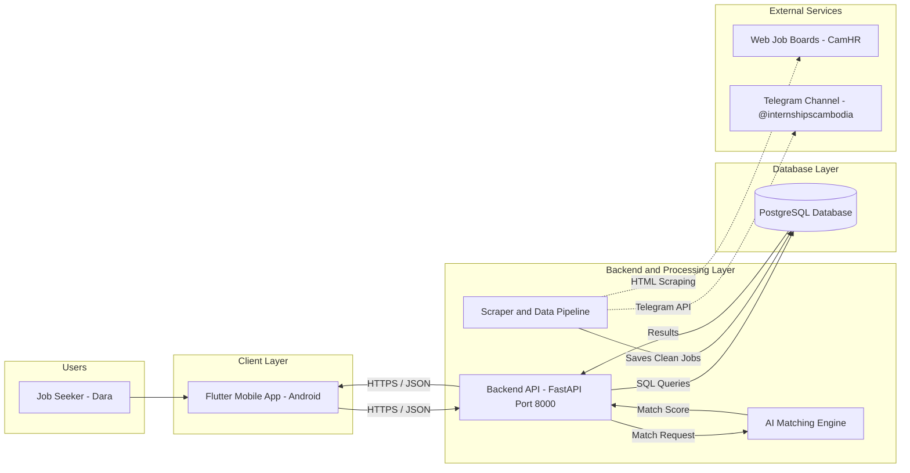
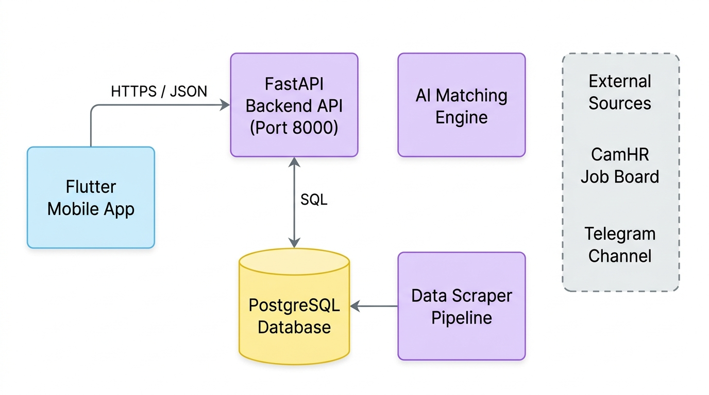

# Phase 3.2 — System Architecture Map

**Objective:** Show the parts of your system, what each one is responsible for, and how data moves between them. No application code yet; this is the plan.

**Status:** Submitted · **Last updated:** 2026-10-18

## Done When

- [x] The diagram shows every part you will build or run, plus every external service from Phase 3.1
- [x] The diagram displays on GitHub
- [x] Every box in the diagram has a row in the component table
- [x] One Must-Have flow is traced from start to finish, including what happens when a step fails

## 1. High-Level Component Map

## 2. Components

| Component | Responsibility | Technology | Runs when | Talks to |
|---|---|---|---|---|
| Flutter Mobile App | Provides mobile UI for authentication, skill setup, job discovery, filtering, and external application links | Flutter 3.44 (Dart 3.12) | On user interaction (Android device) | Backend API |
| Backend API | Handles authentication (JWT), routes requests, enforces validation rules, and queries database | Python 3.11, FastAPI | Continuously listening on port 8000 | PostgreSQL Database, AI Matching Engine |
| PostgreSQL Database | Persists users, profiles, normalized job listings, skill taxonomies, and saved bookmarks | PostgreSQL 16 | Continuously (Docker container) | Backend API, Scraper Pipeline |
| Scraper & Data Pipeline | Periodically extracts raw jobs from external websites and Telegram, cleans text, and deduplicates records | Python (BeautifulSoup4, Telethon) | Scheduled daily (cron / APScheduler) or manual trigger | External Job Boards, Telegram Channel, PostgreSQL |
| AI Matching Engine | Computes skill-vector Cosine Similarity and match score percentages (0–100%) between candidates and jobs | Python (scikit-learn, NumPy) | On each recommendations API request | Backend API |
| External Sources | Third-party platforms where vacancies are published | CamHR, BongThom, Telegram (`@internshipscambodia`) | External availability | Scraper Pipeline |

Where do secrets (database password, API keys, token secret) live, and which components can reach the database directly?

> All application secrets—including the PostgreSQL database password, JWT secret signing key, and Telegram API credentials (`api_id` and `api_hash`)—live in a private, git-ignored `.env` file and are loaded through `pydantic-settings`. Only backend processes (the FastAPI application and the background scraper script) have direct access to the database; the Flutter mobile client communicates exclusively over secure HTTPS REST endpoints and never touches the database directly.

## 3. Flow Trace

Flow traced: **Personalized AI Job Recommendations (`F-08`, `UJ-06`)**

| Step | Where | What happens |
|---|---|---|
| 1 | Flutter Mobile App | Dara opens the app and navigates to the Home tab. The app sends an authenticated `GET /api/v1/recommendations` request with header `Authorization: Bearer <token>`. |
| 2 | Backend API (FastAPI) | The API verifies the JWT token. If expired or missing, it returns `401 Unauthorized` and the app directs Dara to the login screen. If valid, it extracts `user_id`. |
| 3 | Backend API ➔ Database | The API queries PostgreSQL for Dara's candidate skills from `profile_skills` and active job listings with their required skills from `job_skills`. |
| 4 | AI Matching Engine | The matching engine vectorizes Dara's skills (`[Flutter, Dart, Firebase]`) against each job's required skills. It calculates Cosine Similarity, generates match score percentages (e.g., 88%), and sorts listings in descending order. |
| 5 | Backend API ➔ Flutter App | The API returns HTTP `200 OK` with a JSON list of recommended jobs, each containing title, company, salary, source badge, match score, and matching/missing skills. |
| 6 | Flutter Mobile App | The app renders the personalized feed displaying job cards with green match score badges (e.g., `88% Match ⚡`). If Dara has not saved any skills yet, the app displays an empty-state prompt: *"Add your skills to unlock personalized AI matches."* |
| Failure Case | Any step | If the database or network is unreachable, the app displays a friendly error banner: *"Unable to load recommendations. Please check your connection."* with a "Retry" button. |
