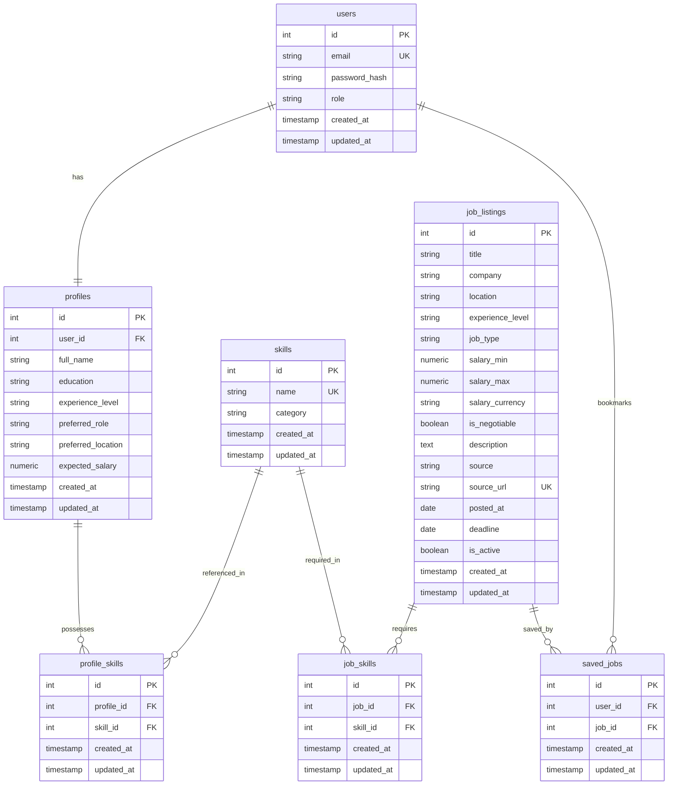
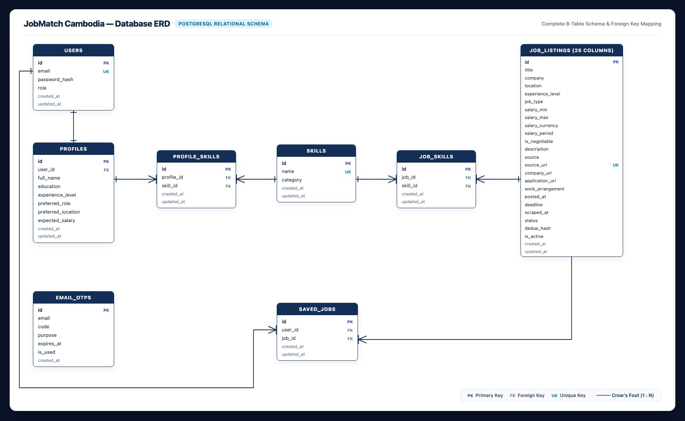

# Phase 3.3 — Database ERD

**Objective:** Design the data model your features need: every table, column, constraint and relationship, decided before any migration is written.

**Status:** Submitted · **Last updated:** 2026-10-18

## Done When

- [x] The ERD covers every Must-Have feature and journey, and renders on GitHub
- [x] Every table has a primary key and created/updated timestamps
- [x] Every foreign key has an on-delete rule in the data dictionary
- [x] No money columns use a floating-point type

## 1. Conventions

- Table names are plural and in snake_case (e.g. `job_listings`, `profile_skills`).
- Every table has a primary key `id`, plus `created_at` and `updated_at`.
- Money values (`salary_min`, `salary_max`, `expected_salary`) are stored as `numeric(10,2)` or integer cents, never as a floating-point type.
- Foreign keys are named `<entity>_id` and indexed.
- Junction tables handle many-to-many relationships (`profile_skills`, `job_skills`).

## 2. Entity Relationship Diagram

## 3. Data Dictionary

### Table: `users`
Stores user credentials and security roles.

| Column | Data type | Constraints | Nullable | Description |
|---|---|---|---|---|
| id | integer | PRIMARY KEY, SERIAL | No | Unique account identifier |
| email | varchar(255) | UNIQUE | No | User login email address |
| password_hash | varchar(255) | | No | Bcrypt hashed password |
| role | varchar(20) | DEFAULT 'user', CHECK (role IN ('user', 'admin')) | No | Authorization role |
| created_at | timestamp | DEFAULT now() | No | When the user registered |
| updated_at | timestamp | DEFAULT now() | No | When the user account was last modified |

---

### Table: `profiles`
Stores personal and professional information for candidate matching. Connected 1:1 with `users`.

| Column | Data type | Constraints | Nullable | Description |
|---|---|---|---|---|
| id | integer | PRIMARY KEY, SERIAL | No | Unique profile identifier |
| user_id | integer | UNIQUE, FK → users.id ON DELETE CASCADE | No | Associated user account |
| full_name | varchar(150) | | No | Candidate display name |
| education | varchar(150) | | Yes | University degree or major (e.g. Computer Science) |
| experience_level | varchar(50) | CHECK (experience_level IN ('entry', 'junior', 'mid', 'senior')) | No | Career seniority level |
| preferred_role | varchar(100) | | No | Target job title (e.g. Mobile Developer) |
| preferred_location | varchar(100) | | No | Preferred work city (e.g. Phnom Penh) |
| expected_salary | numeric(10,2) | CHECK (expected_salary >= 0) | Yes | Monthly expected salary in USD |
| created_at | timestamp | DEFAULT now() | No | When the profile was created |
| updated_at | timestamp | DEFAULT now() | No | When the profile was last updated |

---

### Table: `skills`
Master catalog of standardized technical and soft skill tokens.

| Column | Data type | Constraints | Nullable | Description |
|---|---|---|---|---|
| id | integer | PRIMARY KEY, SERIAL | No | Unique skill identifier |
| name | varchar(50) | UNIQUE | No | Normalized skill tag (e.g. Flutter, Dart, Firebase, Git) |
| category | varchar(50) | | No | Category (e.g. Mobile, Backend, Database, Marketing) |
| created_at | timestamp | DEFAULT now() | No | When the skill was added |
| updated_at | timestamp | DEFAULT now() | No | When the skill was last updated |

---

### Table: `profile_skills`
Junction table linking candidate profiles with their selected skills.

| Column | Data type | Constraints | Nullable | Description |
|---|---|---|---|---|
| id | integer | PRIMARY KEY, SERIAL | No | Unique junction identifier |
| profile_id | integer | FK → profiles.id ON DELETE CASCADE | No | Candidate profile reference |
| skill_id | integer | FK → skills.id ON DELETE CASCADE | No | Standardized skill reference |
| created_at | timestamp | DEFAULT now() | No | When the skill was associated with the profile |
| updated_at | timestamp | DEFAULT now() | No | When the record was updated |

---

### Table: `job_listings`
Stores clean, normalized job vacancies aggregated from external sources.

| Column | Data type | Constraints | Nullable | Description |
|---|---|---|---|---|
| id | integer | PRIMARY KEY, SERIAL | No | Unique job listing identifier |
| title | varchar(200) | | No | Normalized job title |
| company | varchar(150) | | No | Verified hiring organization name |
| location | varchar(100) | | No | Job location (e.g. Phnom Penh, Remote) |
| experience_level | varchar(50) | DEFAULT 'entry' | No | Required seniority level |
| job_type | varchar(50) | DEFAULT 'full-time' | No | Employment type (full-time, part-time, internship) |
| salary_min | numeric(10,2) | CHECK (salary_min >= 0) | Yes | Minimum salary in USD (no float) |
| salary_max | numeric(10,2) | CHECK (salary_max >= salary_min) | Yes | Maximum salary in USD (no float) |
| salary_currency | varchar(10) | DEFAULT 'USD' | No | Currency denomination |
| is_negotiable | boolean | DEFAULT false | No | Whether salary is marked negotiable |
| description | text | | No | Full job description and requirements text |
| source | varchar(50) | | No | Origin platform ('Telegram', 'CamHR', 'BongThom') |
| source_url | text | UNIQUE | No | Direct URL to original post for external application |
| posted_at | date | | Yes | Original publication date on source platform |
| deadline | date | | Yes | Application deadline |
| is_active | boolean | DEFAULT true | No | Whether the vacancy is currently active |
| created_at | timestamp | DEFAULT now() | No | When the listing was ingested into database |
| updated_at | timestamp | DEFAULT now() | No | When the listing was last updated |

---

### Table: `job_skills`
Junction table linking job listings with their required skills (extracted via NLP/parsing).

| Column | Data type | Constraints | Nullable | Description |
|---|---|---|---|---|
| id | integer | PRIMARY KEY, SERIAL | No | Unique junction identifier |
| job_id | integer | FK → job_listings.id ON DELETE CASCADE | No | Job listing reference |
| skill_id | integer | FK → skills.id ON DELETE CASCADE | No | Required skill reference |
| created_at | timestamp | DEFAULT now() | No | When the skill was tagged to the job |
| updated_at | timestamp | DEFAULT now() | No | When the record was updated |

---

### Table: `saved_jobs`
Stores user bookmarks for listings saved to be reviewed or applied to later.

| Column | Data type | Constraints | Nullable | Description |
|---|---|---|---|---|
| id | integer | PRIMARY KEY, SERIAL | No | Unique bookmark identifier |
| user_id | integer | FK → users.id ON DELETE CASCADE | No | User who bookmarked the vacancy |
| job_id | integer | FK → job_listings.id ON DELETE CASCADE | No | Bookmarked vacancy reference |
| created_at | timestamp | DEFAULT now() | No | When the bookmark was saved |
| updated_at | timestamp | DEFAULT now() | No | When the bookmark record was updated |

---

### Table: `email_otps`
Stores temporary 6-digit OTP verification codes for email verification and passwordless authentication.

| Column | Data type | Constraints | Nullable | Description |
|---|---|---|---|---|
| id | integer | PRIMARY KEY, SERIAL | No | Unique OTP identifier |
| email | varchar(255) | INDEX | No | Target recipient email address |
| code | varchar(6) | | No | 6-digit cryptographic verification code |
| purpose | varchar(50) | DEFAULT 'login_or_verify' | No | Purpose of OTP ('register', 'login', 'reset') |
| expires_at | timestamptz | | No | Expiration timestamp (default 10 minutes) |
| is_used | boolean | DEFAULT false | No | Whether this code was already consumed |
| created_at | timestamptz | DEFAULT now() | No | When the code was generated |
