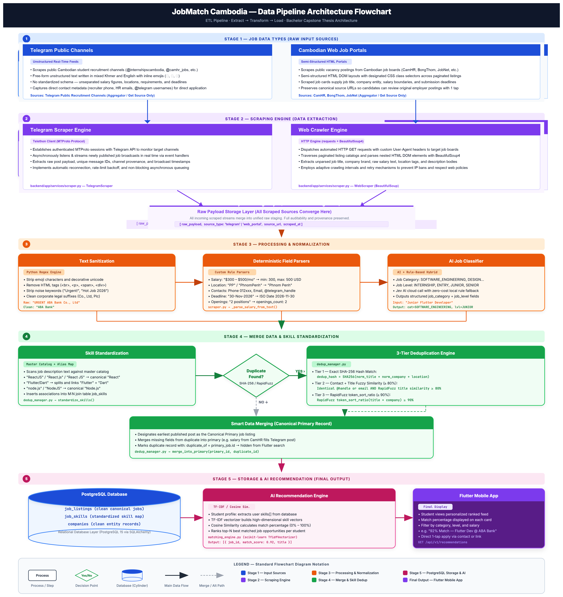
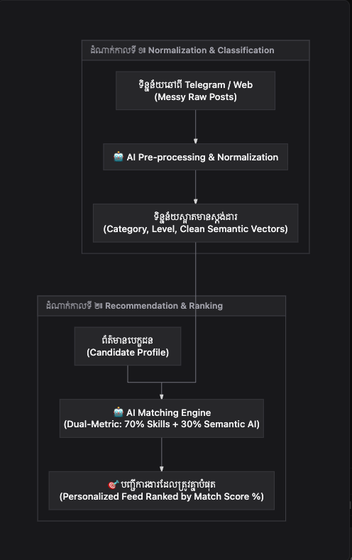
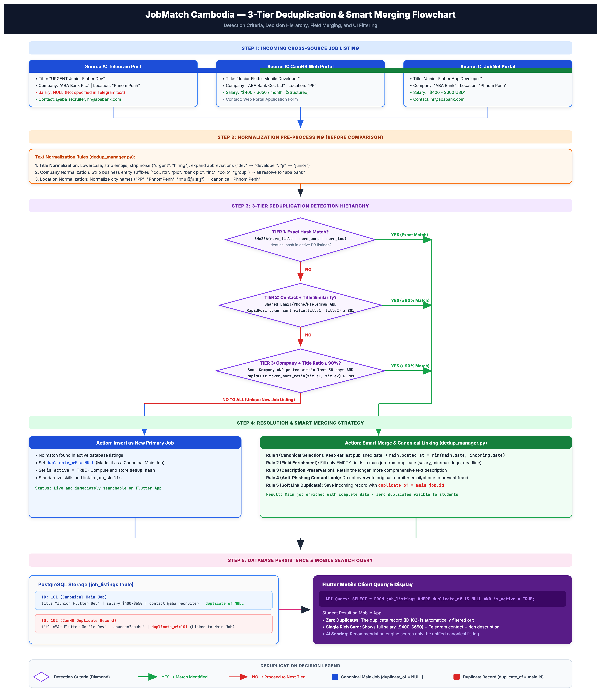

# Phase 3.5 — Job Data Pipeline Architecture

**Objective:** Document the end-to-end Extract, Transform, Load (ETL) data pipeline that ingests, cleans, standardizes, deduplicates, and stores Cambodian recruitment posts for the AI recommendation engine.

**Status:** Draft · **Last updated:** 2026-11-04

---

## 1. Editable Diagram Link (Draw.io / Google Drive)

> [!TIP]
> **Draw.io Source Diagram:**  
> The editable vector diagram source file is hosted on Google Drive:  
> 🔗 **[Open / Download Draw.io Diagram File on Google Drive](https://drive.google.com/file/d/1EH3s90BtcGFPcgdMEFUoFmLql04RyMis/view?usp=sharing)**
> 
> **How to open in Draw.io:**
> 1. Visit [app.diagrams.net](https://app.diagrams.net/)
> 2. Click **File** ➔ **Open From** ➔ **Google Drive** (or download the file from the link and choose **Device**)
> 3. You can edit nodes, connectors, and colors directly.

---

## 2. Pipeline Architecture Flowchart



### 2.1 Dual-Phase AI Pipeline (Normalization vs Recommendation)

The architecture explicitly decouples the two AI processing phases:
1. **Phase 1: Ingestion, Normalization & Classification:** Raw posts from Telegram & Web ➔ Staging Tables (`telegram_jobs`, `web_jobs`) ➔ Text cleaning (`re`), Khmer numerals translation (`str.maketrans`), Semantic vocabulary normalization (`paraphrase-multilingual-MiniLM-L12-v2`), and taxonomy classification ➔ Canonical Master table (`job_listings`).
2. **Phase 2: Dual-Metric AI Recommendation & Ranking:** Candidate Profile + Canonical Jobs ➔ 70% Skill Coverage + 30% Multilingual Semantic AI Similarity ➔ Personalized Feed ranked by Match Score % served to the Flutter Mobile App.



---

## 3. Pipeline Stages Breakdown

The JobMatch Cambodia data pipeline operates in **5 sequential stages**:

### Stage 1: Job Data Types (Raw Input Sources)
Recruitment opportunities in Cambodia are published across fragmented channels with varying structures. The platform aggregates exclusively from **two external scraped sources**:

1. **Telegram Public Channels (`@internshipscambodia`, `@camhr_jobs`, etc.):**
   - **Type:** Unstructured free-form text.
   - **Characteristics:** Written in mixed Khmer and English, containing decorative emojis (`🔥`, `⚡`, `📢`), unformatted salary strings, and inline contact handles without schema.
   - **Provenance:** Aggregator / Get Source only. Captured via MTProto.
2. **Web Job Portals (CamHR, BongThom, JobNet, etc.):**
   - **Type:** Semi-structured HTML DOM.
   - **Characteristics:** Job cards organized with CSS class selectors across paginated listing pages, containing job title, company name, salary range, and deadline.
   - **Provenance:** Aggregator / Get Source only. Captured via HTTP crawler.

> [!IMPORTANT]
> **Strict 2-Role & Aggregator Scope:** There is **NO employer portal, NO recruiter login, and NO company direct posting**. The system strictly operates on **two roles only** (`user` for candidates/students and `admin` for pipeline management). Companies exist solely as canonical entities attached to scraped postings.

---

### Stage 2: Scraping Engine [Data Extraction]
Handles automated data collection from the two external sources:
1. **Telegram Scraper Engine (`backend/app/services/scraper.py`):**
   - Built on `Telethon` (MTProto client protocol).
   - Listens to incoming messages in real time from public Cambodian job channels.
   - Extracts raw message text, timestamp, channel ID, and media links.
2. **Web Crawler Engine (`requests` + `BeautifulSoup4`):**
   - Sends automated HTTP requests to Cambodian job boards.
   - Traverses pagination links and parses target HTML DOM tags with CSS selectors.
   - Applies rate-limiting and exponential backoff retry mechanisms to respect web policies.
3. **Raw Payload Storage Layer (All Scraped Sources Converge Here):**
   - Both scraped incoming streams converge into a raw staging table before any destructive processing.
   - Preserves `raw_payload`, `source_type` (`telegram` | `web_portal`), and `source_url` for full auditability and traceability.

---

### Stage 3: Processing & Normalization
Converts noisy raw text into clean, structured fields:
1. **Text Sanitization (Python Regex Engine):**
   - Strips non-standard emojis and decorative unicode characters.
   - Removes HTML tags (`<br>`, `<p>`, `<span>`, `<div>`) and extra whitespaces.
   - Removes marketing noise words (e.g., *"Urgent Hiring!"*, *"Apply Now"*, *"Hot Job 2026"*).
   - Cleans corporate legal suffixes (e.g., `"ABA Bank Co., Ltd"` $\rightarrow$ `"ABA Bank"`).
2. **Deterministic NLP Field Parsers:**
   - **Salary Parser:** Converts irregular salary text (e.g., `"$300 - $500/month"`) into structured numerical fields: `salary_min = 300.0`, `salary_max = 500.0`, `salary_currency = "USD"`.
   - **Location Normalizer:** Maps local variations (`"PP"`, `"PhnomPenh"`, `"រាជធានីភ្នំពេញ"`) to a single canonical city name: `"Phnom Penh"`.
   - **Contact Parser:** Extracts phone numbers (`012 xxx xxx`), HR emails, and Telegram usernames (`@recruiter`).
   - **Deadline Parser:** Normalizes date formats (`30-Nov-2026`, `30/11/2026`) into standard ISO-8601 timestamps (`2026-11-30T00:00:00Z`).
   - **Openings Parser:** Extracts number of vacancies (e.g., `"2 positions"` $\rightarrow$ `openings_count = 2`).
3. **AI Job Classification (`job_classifier.py`):**
   - Classifies canonical `job_category` (e.g., `SOFTWARE_ENGINEERING`, `DESIGN`, `MARKETING`, `FINANCE`).
   - Determines seniority `job_level` (`INTERNSHIP`, `ENTRY`, `JUNIOR`, `SENIOR`).
   - Uses hybrid approach: cloud Jev AI classification with automatic fallback to local rule-based keyword matching.

---

### Stage 4: Merge Data & Skill Standardization
Eliminates cross-platform duplicate postings and normalizes technology skill keywords:

1. **Skill Standardization (`dedup_manager.py`):**
   - Scans cleaned job descriptions against a **Master Skills Catalog** and alias mapping dictionary.
   - Normalizes synonyms to canonical skill records:
     - `"ReactJS"` / `"React.js"` / `"React JS"` $\rightarrow$ canonical **`React`**
     - `"node.js"` / `"NodeJS"` $\rightarrow$ canonical **`Node.js`**
     - Splits compound phrases: `"Flutter/Dart"` $\rightarrow$ **`Flutter`** + **`Dart`**
   - Creates many-to-many associations in `job_skills` join table.
2. **3-Tier Deduplication Engine:**
   - **Tier 1 — Exact SHA-256 Hash Match:** Checks precomputed `dedup_hash = SHA256(norm_title + norm_company + location)`.
   - **Tier 2 — Contact + Title Fuzzy Similarity ($\ge 80\%$):** Matches shared Telegram handle or HR email combined with title string similarity $\ge 80\%$.
   - **Tier 3 — RapidFuzz Token Sort Ratio ($\ge 90\%$):** Compares combined company name and job title using `RapidFuzz` string matching.
3. **Smart Data Merging:**
   - The earliest published post is marked as the **Canonical Primary Job**.
   - Fills missing fields from the duplicate record into the primary record (e.g., salary extracted from CamHR supplements a Telegram post that lacked salary details).
   - Sets `duplicate_of = primary_job.id` on duplicate records so they are hidden from user search results.

---

### Stage 5: Storage & AI Recommendation
Delivers processed data to the end user:
1. **PostgreSQL Relational Database:**
   - Persists clean records in relational tables: `job_listings`, `job_skills`, and `companies`.
2. **AI Recommendation Engine (`matching_engine.py`):**
   - Loads student profile skills and job listing skills.
   - Applies **TF-IDF Vectorization** (scikit-learn `TfidfVectorizer`) and **Cosine Similarity**.
   - Calculates personalized `match_score` ($0\% - 100\%$) for each active job.
3. **Flutter Mobile Client:**
   - Queries `GET /api/v1/recommendations`.
   - Displays ranked internship and junior job cards with matching percentages directly to students.

---

## 4. Deep Dive: Deduplication & Smart Merging Architecture

### 4.1. The Problem Context: Cross-Posting in Cambodia
In the Cambodian recruitment market, hiring managers and HR agencies **simultaneously cross-post the exact same job vacancy** across Telegram channels (`@internshipscambodia`), commercial job boards (CamHR, BongThom, JobNet), and Facebook recruitment groups.

If left unchecked:
* Students on the mobile app would encounter **3 to 5 duplicate cards** for the exact same physical position.
* Recommendation ranking scores would be diluted and repetitive.
* Search results would be cluttered with identical vacancies from different sources.

---

### 4.2. Deduplication & Smart Merging Flowchart



---

### 4.3. Detection Mechanics: Why & How We Know It's a Duplicate
Recruiters use different wording on different channels (e.g., `"🔥 URGENT ABA Bank Plc."` on Telegram vs. `"ABA Bank Co., Ltd"` on CamHR). The system applies a **3-tier detection hierarchy** implemented in `backend/app/services/dedup_manager.py`:

#### 1. Text Normalization Pre-Processing
Before any comparison occurs, the incoming listing is sanitized:
* **Title Normalization (`normalize_text_for_matching`):** Lowercases text, strips emoji characters, removes recruitment noise prefixes (`"urgent"`, `"hiring"`, `"announcement"`), and expands abbreviations (`"dev"` $\rightarrow$ `"developer"`, `"jr"` $\rightarrow$ `"junior"`).
* **Company Normalization (`normalize_company_name`):** Strips corporate legal suffixes (`"co., ltd"`, `"plc"`, `"bank plc"`, `"inc"`, `"corp"`, `"group"`), ensuring `"ABA Bank (Cambodia) Plc."` and `"ABA Bank Co., Ltd"` both normalize to `"aba bank"`.
* **Location Normalization:** Strips trailing country qualifiers and resolves local aliases to `"Phnom Penh"`.

#### 2. Tier 1: Exact Hash Match (SHA-256)
* A deterministic hash key is computed from the normalized fields:
  $$\text{dedup\_hash} = \text{SHA-256}(\text{normalized\_title} \mid \text{normalized\_company} \mid \text{normalized\_location})[:64]$$
* **Rule:** If an active database listing already exists with the identical `dedup_hash` and `duplicate_of IS NULL`, it is an **immediate exact match**.
* **Time Complexity:** $O(1)$ lookup via indexed column `job_listings.dedup_hash`.

#### 3. Tier 2: Same Contact + Title Fuzzy Similarity ($\ge 80\%$)
* When hash matching fails (e.g., slight variation in title phrasing), the engine checks for shared recruiter contact information:
  * Identical `apply_email` (e.g., `hr@ababank.com`), OR
  * Identical `apply_phone` (e.g., `012 345 678`), OR
  * Identical `apply_telegram` (e.g., `@aba_recruiter`).
* If a candidate job shares any contact handle, `RapidFuzz` compares the normalized titles:
  $$\text{fuzz.token\_sort\_ratio}(\text{normalized\_title}_1, \text{normalized\_title}_2) \ge 80\%$$
* If similarity is $\ge 80\%$, the listing is confirmed as a duplicate.

#### 4. Tier 3: Same Company + Title Ratio ($\ge 90\%$) within 30-Day Window
* If contact handles are missing (e.g., web portal webform applications), the engine queries existing active jobs from the same normalized company posted within the last **30 days**:
  $$\text{fuzz.token\_sort\_ratio}(\text{normalized\_title}_1, \text{normalized\_title}_2) \ge 90\%$$
* If similarity is $\ge 90\%$, it is confirmed as a duplicate.
* **Why 30 days?** Companies frequently re-open the same job position months later. The 30-day window ensures old job listings are not mistakenly merged with fresh recruitment cycles.

---

### 4.4. Resolution Strategy: How We Solve It (Smart Data Merging)
The system **does not discard or delete duplicate listings**. Discarding would cause data loss because different sources contain complementary information (e.g., Telegram listings have fast direct Telegram handles but lack salary ranges, while CamHR listings have structured salary ranges but lack direct Telegram handles).

Instead, `merge_into_main_job()` executes an order-independent **Smart Merge Strategy**:

1. **Canonical Main Job Selection:**
   * The listing with the earliest published timestamp (`posted_at`) is maintained as the **Canonical Main Job** (`duplicate_of = NULL`).
2. **Missing Field Enrichment:**
   * The canonical main job's empty fields are populated using data from the duplicate:
     * **Salary:** If `main.salary_min IS NULL`, it is enriched from `duplicate.salary_min`, `salary_max`, and `salary_currency`.
     * **Company Assets:** `company_logo_url` and `company_url` are populated if missing in the main job.
     * **Application Details:** `deadline`, `work_arrangement`, and `openings` count are filled if absent.
3. **Description Preservation:**
   * The longer, more informative description text is retained to ensure students receive full job requirements.
4. **Anti-Phishing Contact Protection:**
   * Recruiter contact details (`apply_email`, `apply_phone`, `apply_telegram`) on the main job are **locked and never overwritten** by subsequent duplicate posts. This prevents third-party spoofed postings from hijacking legitimate contact links.
5. **Soft Linking (`duplicate_of`):**
   * The duplicate row is preserved in PostgreSQL for auditing, but tagged with:
     $$\text{duplicate\_of} = \text{main\_job.id}$$
6. **Mobile Query Suppression:**
   * The FastAPI endpoint serves mobile screens using the filter:
     ```sql
     SELECT * FROM job_listings WHERE duplicate_of IS NULL AND is_active = TRUE;
     ```
   * **Result on Flutter App:** Students see a single, rich, fully-populated job card with verified salary, complete description, and legitimate contact channels.

---

### 4.5. Edge Cases & Safety Matrix

| Edge Case Scenario | Potential Risk | System Defense & Solution |
|---|---|---|
| **Slight Company Misspelling** (e.g. "ABA Bankk" vs "ABA Bank") | Missed duplicate | Normalized company stripping + RapidFuzz Token Sort Ratio accommodates up to 10% token variance. |
| **Two Different Jobs at Same Company** (e.g. Junior Mobile Dev vs Junior Web Dev) | Accidental false-positive merge | RapidFuzz token sort ratio between "mobile developer" and "web developer" is only 73% (below the 90% threshold), preventing false merges. |
| **Job Re-advertised 6 Months Later** | Stale job overwritten | Tier 3 enforces a strict **30-day cutoff**. Re-advertised positions after 30 days are treated as brand new active vacancies. |
| **Phishing / Impersonation Scrape** | Legitimate contact handle hijacked | Anti-phishing contact lock: Contact fields on the established primary job are immutable to duplicate incoming scrapes. |
| **Order of Scraping Reversed** (CamHR scraped before Telegram) | Inconsistent primary job | Order-independent merging: Regardless of which source is ingested first, earliest `posted_at` always wins canonical status. |

---

## 5. Additional Technical Architecture & Missing Safeguards

### 5.1 Tier 0 — Source Identity Verification

Before executing the three-tier matching hierarchy, the system checks whether the incoming posting has already been collected from the same original source.

**Detection criteria:**
- Same `source_id` / `source`.
- Same `source_job_id` / `source_post_id`, when provided by the source.
- Alternatively, the same normalized original source URL when reliable (`source_url`).

Example:

```text
Existing:
source = "telegram"
source_post_id = "123456"

Incoming:
source = "telegram"
source_post_id = "123456"
```

**Decision:** The posting has already been collected. The system updates its observation timestamp (`last_seen_at = datetime.utcnow()`) instead of inserting another duplicate source record.

For PostgreSQL, the system implements a unique constraint on the source identity fields:
```sql
CONSTRAINT uq_job_listings_source_post_id UNIQUE (source, source_post_id);
```
This tier prevents repeated scraping of the same Telegram message or web portal listing during hourly cron jobs.

### 5.2 Candidate Retrieval & Matching Scope

The system does not compare every incoming job against every record in the database, which would result in an unacceptable $O(N)$ fuzzy matching bottleneck.

Instead, it retrieves a narrow candidate pool using indexed fields:
- Filter strictly by canonical active jobs (`duplicate_of IS NULL AND is_active = TRUE`).
- Same normalized company name.
- Matching recruiter contact information (email or phone).
- Relevant publication date window (e.g., jobs posted within the last 30 days).

PostgreSQL indexes implemented and recommended:
- `dedup_hash` (B-Tree index for $O(1)$ Tier 1 lookups)
- `duplicate_of` (Foreign Key index for fast canonical filtering)
- `source`, `source_post_id` (Unique index for Tier 0 idempotency)
- `company_name` / `company_normalized`
- `posted_at` (B-Tree index for range filtering)

This reduces unnecessary comparisons and maintains sub-100ms response times as the database scales.

### 5.3 Duplicate Confidence & Decision Classification

A matching score alone does not guarantee that two job postings represent the same vacancy. The system classifies incoming records into three distinct decision states:

1. **CONFIRMED_DUPLICATE:**
   - Strong source identity evidence; or
   - Multiple independent matching signals (Exact SHA-256 hash match, or verified contact + Title $\ge 80\%$, or Company + 30-day window + Title $\ge 90\%$).
   - **Action:** Automatically merged into canonical root job; duplicate row soft-linked via `duplicate_of`.

2. **POSSIBLE_DUPLICATE:**
   - Borderline title and company similarity without corroborating contact or verified company identity.
   - Requires manual verification or human-in-the-loop review.
   - **Action:** Must not be automatically merged to prevent false-positive data corruption.

3. **NEW_JOB:**
   - No sufficiently strong duplicate evidence found.
   - **Action:** Inserted as a new canonical primary job (`duplicate_of = NULL`).

The 80% and 90% RapidFuzz thresholds are initial configurable parameters evaluated against labeled Cambodian job-posting samples.

### 5.4 Canonical Job Selection & Relationship Integrity (Star Topology)

Canonical selection is deterministic and independent of scraping ingestion order:
1. **Timestamp Precedence:** Prefer trustworthy original publication timestamp (`posted_at`).
2. **Fallback Policy:** If original timestamps are missing or equal, use earliest discovery time (`first_seen_at` / `scraped_at`).
3. **Deterministic Tie-Breaker:** Stable primary key comparison (`existing.id`).
4. **Star Topology Guarantee:** All duplicate records point directly to the canonical root job.

```text
Correct (Star Topology):
Canonical Job: ID 100 (duplicate_of = NULL)
Duplicate Job: ID 101 (duplicate_of = 100)
Duplicate Job: ID 102 (duplicate_of = 100)

Forbidden (Duplicate Chain):
Job 101 -> duplicate_of = 100
Job 102 -> duplicate_of = 101  <-- Disallowed by dedup query constraints
```

All candidate queries explicitly filter by `duplicate_of.is_(None)`, mathematically eliminating multi-hop chains or circular references.

### 5.5 Source Data Preservation & Provenance

The system preserves original information collected from each platform rather than overwriting it destructively.

#### Extended Schema: `job_sources`
To track platform provenance at high scale, the architectural model specifies:
- `id`: Unique source identity key
- `job_id`: Foreign key referencing canonical `job_listings.id`
- `source`: Telegram (`telegram`), Web Portals (`web_portal` - CamHR, BongThom, JobNet)
- `source_job_id`: Original posting ID on source platform
- `source_url`: Original posting URL
- `original_title`: Raw unnormalized title
- `original_company`: Raw unnormalized company string
- `original_salary`: Raw unparsed salary text
- `original_description`: Full raw description text
- `original_contact`: Raw phone/email/telegram handles
- `posted_at`: Original publication timestamp
- `first_seen_at`: First collection timestamp
- `last_seen_at`: Most recent successful observation timestamp

This allows JobMatch Cambodia to present one clean canonical card while preserving the immutable source record from every platform.

### 5.6 Field-Level Conflict Resolution

The system never assumes incoming information is superior to existing canonical data. Field resolution follows a strict safety matrix:

| Field | Resolution Strategy |
|---|---|
| **Job Title** | Retain canonical title from earliest trustworthy listing |
| **Company** | Use normalized identity; preserve original source names |
| **Salary** | Enrich only if canonical is `NULL`; preserve range bounds |
| **Description** | Retain the more complete and informative description |
| **Deadline** | Prefer verified, future deadline; retain active dates |
| **Location** | Compare normalized locations; flag geographical conflicts |
| **Contact Info** | Preserve verified recruiter channels; never overwrite with unverified data |
| **Company Logo** | Enrich only when missing and source is verified |
| **Source URL** | Preserve distinct source URLs across all duplicate records |

### 5.7 Contact Verification & Anti-Phishing Protection

The system distinguishes between an existing contact and a verified contact:
- **Verification Statuses:** `unverified`, `source_verified`, `manually_verified`, `flagged`.
- **Anti-Phishing Rule:** An incoming duplicate must **never** overwrite an established verified contact with an unverified contact.
- When an incoming scrape presents conflicting contact information for the same company, the conflict is flagged for administrative review rather than silently accepted.

### 5.8 Transaction & Concurrent Scraping Protection

When multiple background workers scrape vacancies concurrently:
- Idempotency is enforced at the database level via unique constraints (`source + source_post_id` and `source_url`).
- Duplicate detection, canonical election, and field enrichment execute within an atomic SQLAlchemy database transaction (`db.commit() / db.rollback()`).
- Re-checks canonical record status before committing merges, preventing split-brain canonical states.

### 5.9 Job Expiration & Reposting Management

Deduplication and vacancy expiration are decoupled processes:
- `posted_at`: Original publication timestamp.
- `first_seen_at`: First discovery timestamp by JobMatch scraper.
- `last_seen_at`: Most recent verification that post is still live.
- `deadline`: Explicit application closing date.
- `is_active` / `status`: Lifecycle state (`ACTIVE`, `EXPIRED`, `CLOSED`).

A 30-day window evaluates whether a post belongs to the *same* recruitment cycle. If a company posts the same title after 6 months, it is treated as a genuinely new vacancy cycle rather than an old duplicate.

### 5.10 Deduplication Audit Logging

Every automatic matching and merging decision is traceable for transparency:

#### Table: `deduplication_logs`
- `id`: Auto-incrementing log ID
- `incoming_job_id`: New job being evaluated
- `matched_job_id`: Candidate job matched against
- `canonical_job_id`: Elected canonical job ID
- `matching_tier`: Tier 0, Tier 1, Tier 2, or Tier 3
- `similarity_score`: Computed RapidFuzz token score (0-100)
- `decision`: `CONFIRMED_DUPLICATE` | `POSSIBLE_DUPLICATE` | `NEW_JOB`
- `decision_reason`: Human-readable justification string
- `created_at`: Timestamp of evaluation

---

## 6. Database Integrity & Mobile Query Rules

### 6.1 Canonical Job Integrity
1. Canonical jobs must have `duplicate_of = NULL`.
2. Duplicate records must reference an existing canonical job ID (`duplicate_of = main.id`).
3. A job cannot reference itself (`CHECK (duplicate_of != id)`).
4. No duplicate chains: duplicates cannot reference other duplicates.

### 6.2 Flutter Mobile Search Query

The mobile search API endpoint serves clean, canonical, and currently active listings:

```sql
SELECT *
FROM job_listings
WHERE duplicate_of IS NULL
  AND is_active = TRUE
  AND (
      deadline IS NULL
      OR deadline >= CURRENT_DATE
  )
ORDER BY posted_at DESC;
```

---

## 7. Testing & Evaluation Strategy

### 7.1 Functional Test Cases

| Test Case | Scenario | Expected Outcome | Code Verification |
|---|---|---|---|
| **TC-01** | Same Telegram message scraped twice | Tier 0 Source Identity match; update `last_seen_at` | PASS (`test_dedup.py`) |
| **TC-02** | Exact same job cross-posted on CamHR & Telegram | Tier 1 SHA-256 hash match; soft-linked | PASS (`test_dedup.py`) |
| **TC-03** | Shared Telegram handle + Title $\ge 80\%$ similarity | Tier 2 fuzzy match; soft-linked | PASS (`test_dedup.py`) |
| **TC-04** | Same recruiter email, completely different job | Similarity $< 80\%$; inserted as separate new job | PASS (`test_dedup.py`) |
| **TC-05** | Same company + 30-day window + Title $\ge 90\%$ | Tier 3 fuzzy match; soft-linked | PASS (`test_dedup.py`) |
| **TC-06** | Same company + same title reposted after 90 days | Outside 30-day window; created as new job | PASS (`test_dedup.py`) |
| **TC-07** | Duplicate has salary, canonical has `NULL` | Canonical enriched with duplicate's salary | PASS (`test_dedup.py`) |
| **TC-08** | Duplicate has longer description | Canonical preserves the longer description text | PASS (`test_dedup.py`) |

### 7.2 Evaluation Metrics

The deduplication engine is evaluated on precision, recall, and reliability:
- **Precision:** $\frac{TP}{TP + FP}$ — Ensures distinct jobs are never mistakenly merged (protecting job diversity).
- **Recall:** $\frac{TP}{TP + FN}$ — Measures percentage of real-world cross-posted duplicates successfully detected.
- **F1-Score:** Harmonic mean of precision and recall.
- **False Positive Rate:** Target $< 1\%$ to guarantee legitimate vacancies are not hidden from students.

### 7.3 Manual Verification Dataset
Curated benchmark set of 100 labeled Cambodian recruitment posts across Telegram, CamHR, and JobNet to validate threshold robustness before production deployment.

---

## 8. Final Architecture Conclusion

The JobMatch Cambodia Deduplication & Smart Merging Engine solves the fragmented multi-platform recruitment challenge in Cambodia.

By combining:
1. **Tier 0 Source Identity Verification** (preventing repeated scraper inserts),
2. **Tier 1 SHA-256 Normalized Hashing** ($O(1)$ exact duplicate matching),
3. **Tier 2 Recruiter Contact & Fuzzy Matching** (cross-platform linkage),
4. **Tier 3 Temporal Company Matching** (30-day window heuristic),
5. **Star Topology Soft-Linking & Non-Destructive Merging** (`duplicate_of`),

the architecture guarantees that **one real-world vacancy is represented by exactly one canonical job card in Flutter**, while all source data and audit trails remain permanently preserved.

---

## 9. End-to-End Concrete Example

### Step 1: Raw Ingested Text (Telegram Post)
```text
🔥 URGENT HIRING!! 🔥
Company: ABA Bank (Cambodia) Plc.
Position: Junior Flutter Mobile Developer (2 positions)
Location: Phnom Penh
Salary: $400 - $650 / month
Requirements:
- Good knowledge of Flutter/Dart, RESTful API, Git
- Fresh grads welcome!
Deadline: 30-Nov-2026
Apply CV to: @aba_recruitment or hr@ababank.com
```

### Step 2: Final Database Entity (`job_listings` in PostgreSQL)
```json
{
  "id": 1042,
  "title": "Junior Flutter Mobile Developer",
  "company_name": "ABA Bank",
  "job_category": "SOFTWARE_ENGINEERING",
  "job_level": "JUNIOR",
  "location": "Phnom Penh",
  "salary_min": 400.00,
  "salary_max": 650.00,
  "salary_currency": "USD",
  "openings_count": 2,
  "application_deadline": "2026-11-30T00:00:00Z",
  "contact_telegram": "aba_recruitment",
  "contact_email": "hr@ababank.com",
  "standardized_skills": [
    {"id": 12, "name": "Flutter"},
    {"id": 13, "name": "Dart"},
    {"id": 45, "name": "RESTful API"},
    {"id": 50, "name": "Git"}
  ],
  "dedup_hash": "a8f3c719e420...b291",
  "duplicate_of": null,
  "source_type": "telegram"
}
```

---

## 10. Component & Codebase Traceability

| Pipeline Stage | Function / Responsibility | Key Code Files |
|---|---|---|
| **1. Input Ingestion** | Two-channel scraped collection (Telegram & Web Portals) | `backend/app/services/scraper.py` |
| **2. Text Normalization** | Regex sanitization, corporate suffix stripping | `backend/app/services/dedup_manager.py` (`normalize_text_for_matching`) |
| **3. Deterministic Parsing** | Salary ranges, canonical cities, ISO deadlines | `backend/app/services/scraper.py` (`_parse_salary_from_text`) |
| **4. AI Classification** | Categorization & seniority level prediction | `backend/app/services/job_classifier.py` (`classify_job_fields`) |
| **5. Skill Standardization** | Master catalog lookup & alias resolution | `backend/app/services/dedup_manager.py` (`standardize_skills`) |
| **6. Deduplication Engine** | 3-tier matching (SHA-256, Contact, RapidFuzz) | `backend/app/services/dedup_manager.py` (`find_matching_main_job`) |
| **7. Smart Data Merging** | Canonical election, field enrichment, soft linking | `backend/app/services/dedup_manager.py` (`merge_into_main_job`) |
| **8. Storage & Recommender** | Relational persistence & TF-IDF Cosine Scoring | `backend/app/models/models.py`, `backend/app/services/matching_engine.py` |
