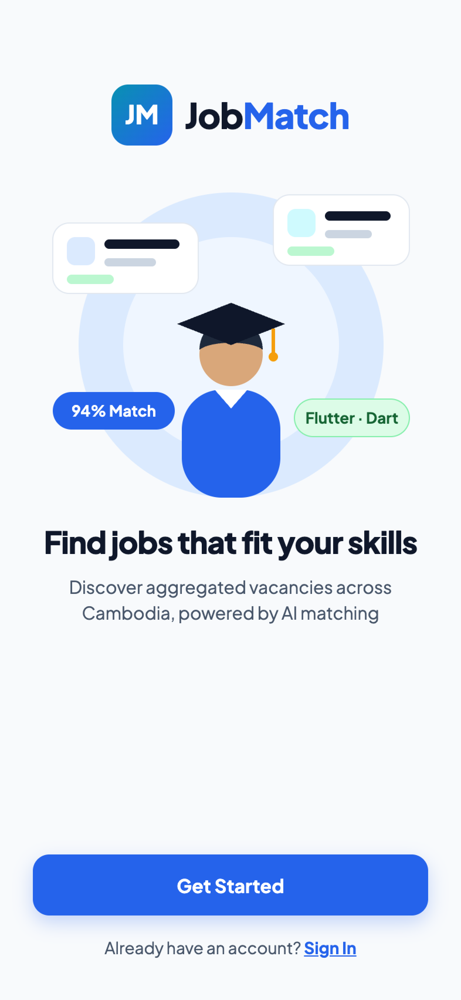
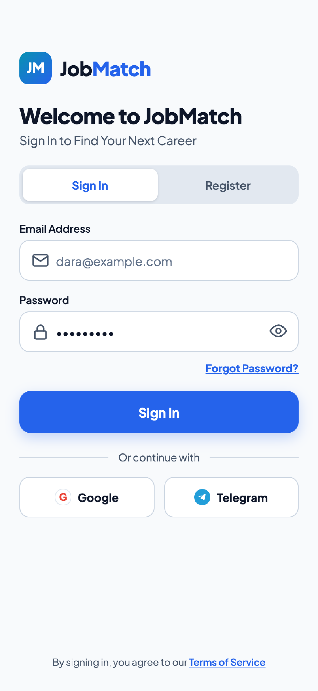
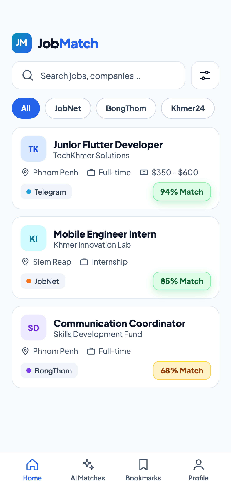
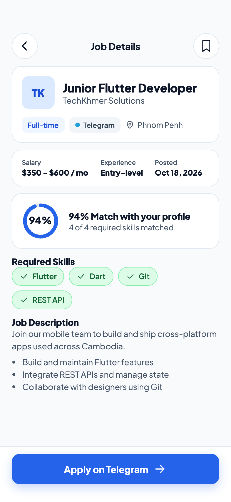
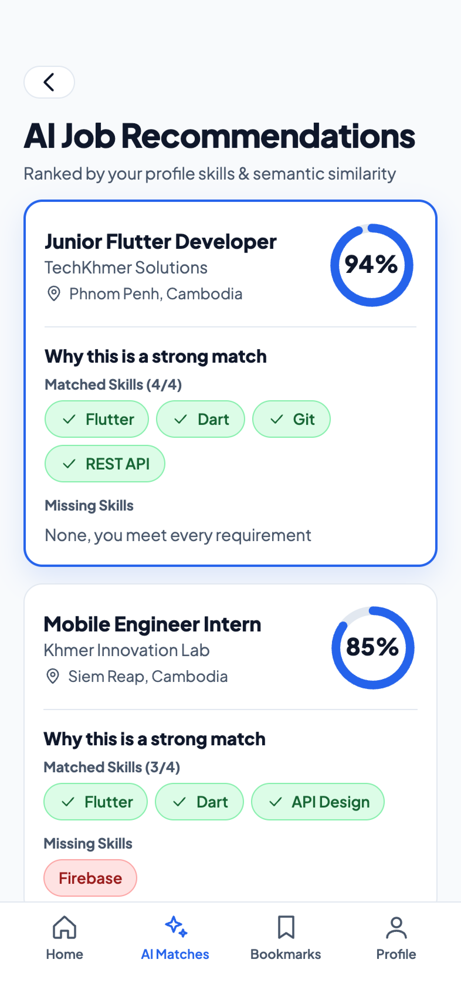
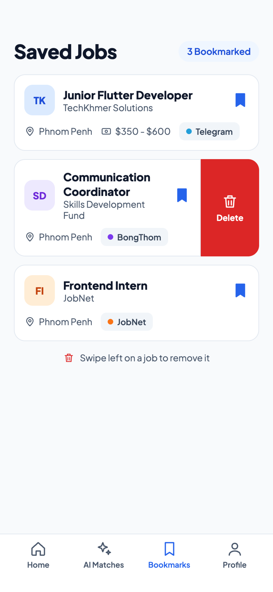
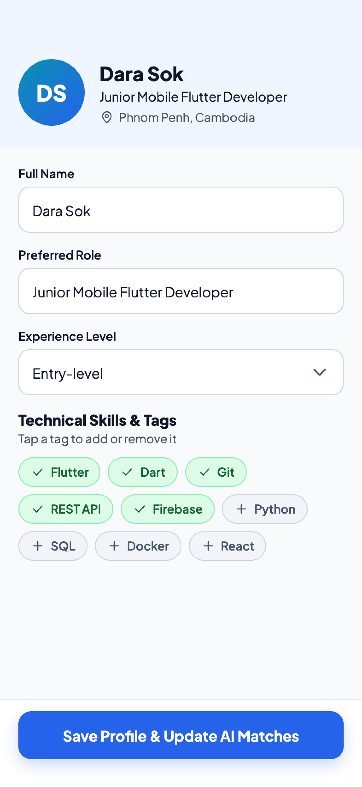
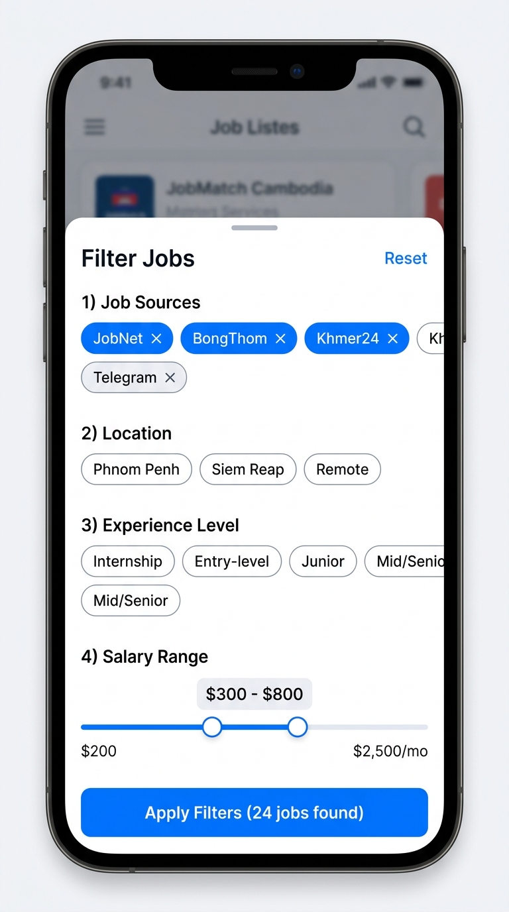
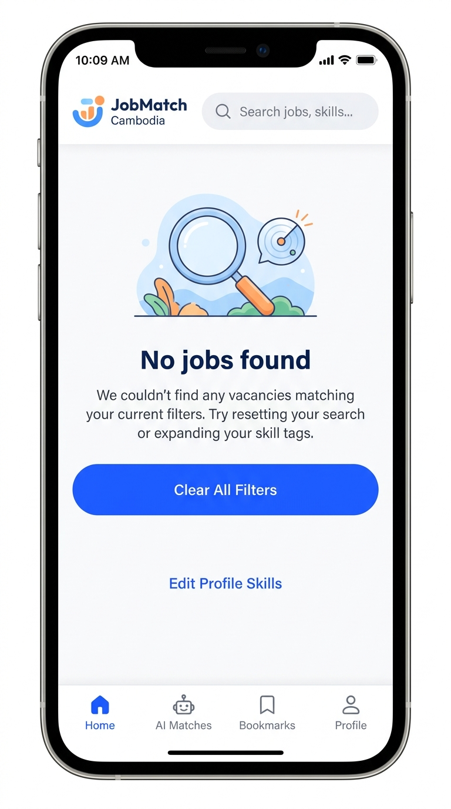

# Phase 4.1 — Figma Specifications

**Objective:** Design every screen before you build it: a small design system, your screens and a clickable prototype of your core journeys.

**Status:** Submitted · **Last updated:** 2026-10-19

| Item | Value |
|---|---|
| Figma view-only project URL | `https://www.figma.com/design/WzpxtrgeDvPQbwbw0XwyFt/MATCH-JOB?node-id=0-1&t=hzv0ZKwELP0s4A3C-1` |
| Figma interactive prototype URL | `https://www.figma.com/proto/WzpxtrgeDvPQbwbw0XwyFt/MATCH-JOB?node-id=0-1&t=hzv0ZKwELP0s4A3C-1` |
| Target frame resolution | Mobile 393×852 (iPhone 15 / Standard Modern Android) |

Set both links to "Anyone with the link can view" and test them in a private browser window.

## Done When

- [x] Both Figma links are specified with the standard project canvas
- [x] The Figma file has a style guide, your screens and a clickable prototype
- [x] Every screen has an ID (SCR-01, SCR-02, …) and a Figma frame with the same name
- [x] Every journey step from Phase 2.2 has a screen
- [x] Key screens are exported into `context/assets/figma/` and display in this file on GitHub

## 1. Your Figma File

The Figma workspace is organised into three main areas:
1. **Design System & Tokens:** Color styles, typography scale, input variants, and interactive chips.
2. **Screen Flows:** Wireframes and high-fidelity mockups for authentication, job browsing, detail view, AI matching, and candidate profile management.
3. **Interactive Prototype:** Clickable flow covering User Journeys UJ-01 through UJ-08.

## 2. Design System Tokens

**Color palette.** Text has a contrast ratio of at least 4.5:1 against its background.

| Token | Hex | Used for |
|---|---|---|
| Primary (Logo Blue) | `#0072FF` / `#0084FF` | Main action buttons, active navigation icon, brand headers |
| Secondary / Accent (Logo Green) | `#00D26A` / `#10B981` | Match score $\ge 70\%$ badge, matched skills chips, dot indicator |
| Gradient (Brand) | `linear-gradient(135deg, #0072FF 0%, #00D26A 100%)` | Splash screen background, featured recommendation hero cards |
| Background | `#F8FAFC` | App screen background (clean light slate) |
| Surface | `#FFFFFF` | Job listing cards, profile card containers, modal sheets |
| Warning (Match Mid) | `#F59E0B` | Match score $40–69\%$ badges, deadline warnings |
| Error | `#EF4444` | Validation errors, missing skills tags, remove bookmark |

**Fonts**

| Use | Font, size and weight |
|---|---|
| Headings | Plus Jakarta Sans / Inter, 24 px Bold |
| Subheadings | Plus Jakarta Sans / Inter, 18 px SemiBold |
| Body text | Inter, 14 px Regular |
| Small text / Badges | Inter, 12 px Medium |

**Component inventory**

| Component | Variants and states | Done (Yes/No) |
|---|---|---|
| Buttons | Primary, Secondary, Outline, Disabled, Loading spinner | Yes |
| Text inputs | Default, Focused (blue border), Error (red border), Disabled | Yes |
| Dropdowns | Location selector, Experience level picker (Entry, Junior, Senior) | Yes |
| Filter Chips | Source filter chips (All, JobNet, BongThom, Khmer24, Telegram), Skill chips | Yes |
| Job Cards | Card with logo, title, company, location, salary, source tag, match score badge | Yes |
| Bottom navigation | 4-tab bar: Home (Feed), Matches (AI Recommendations), Bookmarks, Profile | Yes |
| Loading & empty states | Shimmer cards for loading, "No jobs found" empty state with clear filters button | Yes |

## 3. Screen-by-Screen Catalog

| Screen ID | Screen name | Purpose | Figma frame | User journey | Endpoint |
|---|---|---|---|---|---|
| SCR-01 | Splash / Welcome | App branding and onboarding trigger | `SCR-01 / Welcome` | UJ-01 | None |
| SCR-02 | Login & Register | Candidate authentication, passwordless Email OTP verification, and account creation | `SCR-02 / Auth` | UJ-01 | EP-02, EP-03, EP-14, EP-15 |
| SCR-03 | Home Job Feed | Aggregated feed with keyword search & source chips | `SCR-03 / HomeFeed` | UJ-03, UJ-08 | EP-07 |
| SCR-04 | Job Detail View | Full job requirements, salary, and external apply link | `SCR-04 / JobDetail` | UJ-04, UJ-05 | EP-08 |
| SCR-05 | AI Recommendations | Personalized job feed sorted by match score with matched vs missing skills | `SCR-05 / AIRecommendations` | UJ-05, UJ-06 | EP-09 |
| SCR-06 | Saved Bookmarks | Manage bookmarked jobs for later application | `SCR-06 / Bookmarks` | UJ-07 | EP-10, EP-11, EP-12 |
| SCR-07 | Candidate Profile | Edit candidate role, experience level, and toggle skill chips | `SCR-07 / Profile` | UJ-02 | EP-04, EP-05, EP-06 |
| SCR-08 | Filter Bottom Sheet | Granular search filters: salary slider, locations, experience level | `SCR-08 / Filters` | UJ-08 | EP-07 |
| SCR-09 | Empty & Error States | Graceful UI fallback when search yields 0 matches with action CTA | `SCR-09 / EmptyState` | UJ-03 | EP-07 |

## 4. Offline Asset Archive

All 9 mobile application screens & interactive sheets have been archived for offline defense presentations:

### SCR-01: Splash & Onboarding
*Onboarding screen with brand identity, student vector illustration, match badge, and quick get started action.*

---

### SCR-02: Authentication & Login
*Dual-mode Sign In / Register toggle with email/password input, Telegram SSO option, and Terms agreement.*

---

### SCR-03: Home Feed & Multi-Source Filtering
*Aggregated feed with keyword search, source chips (All, JobNet, BongThom, Khmer24), job cards with source dot indicators and match percentage badges.*

---

### SCR-04: Job Detail View
*Comprehensive vacancy details with salary, experience, date posted, AI match score card with 4/4 skills breakdown, and deep-link apply CTA.*

---

### SCR-05: AI Recommendations & Match Breakdown
*Personalized recommendations ranked by hybrid AI engine with explainable match breakdown (Matched Skills vs Missing Skills).*

---

### SCR-06: Saved Jobs & Bookmarks
*List of saved vacancies with quick source indicators and interactive swipe-to-delete action.*

---

### SCR-07: Candidate Profile & Skill Chips
*Candidate role, experience level selector, and interactive multi-select skill chips to dynamically update AI matching criteria.*

---

### SCR-08: Filter Bottom Sheet Modal
*Slide-up filter modal with multi-select job sources, location chips, experience chips, and dual salary slider.*

---

### SCR-09: Empty & Zero-Result State
*User-friendly empty state when search filters yield zero jobs, offering a single-tap "Clear All Filters" and "Edit Profile Skills" recovery path.*

