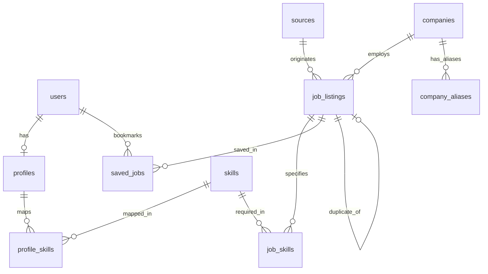

# JobMatch Cambodia — Backend Engineering & Technical Architecture Comprehensive Report

**Academic Program:** Bachelor of Computer Science — Individual Capstone Project  
**Institution:** Royal University of Phnom Penh (RUPP)  
**Author:** RETH CHAN RITH (Student E2)  
**Academic Advisor:** Sopheak  
**Document Version:** 1.0 (Production Release)  
**Last Updated:** 2026-11-10  
**Status:** Complete, Verified & Tested (88/88 Tests Passing)  

---

## Table of Contents

1. [Executive Summary & System Purpose](#1-executive-summary--system-purpose)
2. [Technology Stack & Architectural Decisions](#2-technology-stack--architectural-decisions)
3. [End-to-End System Architecture](#3-end-to-end-system-architecture)
4. [Step-by-Step Setup & Operations Runbook](#4-step-by-step-setup--operations-runbook)
5. [Database Architecture & 3NF Relational Schema](#5-database-architecture--3nf-relational-schema)
6. [Data Ingestion, Sanitization & Normalization Pipeline](#6-data-ingestion-sanitization--normalization-pipeline)
7. [4-Tier Company Entity Resolution](#7-4-tier-company-entity-resolution)
8. [Dual-Metric AI Job Recommendation Engine](#8-dual-metric-ai-job-recommendation-engine)
9. [Hybrid Job Classification & Taxonomy](#9-hybrid-job-classification--taxonomy)
10. [Cross-Source Deduplication & Anti-Phishing Engine](#10-cross-source-deduplication--anti-phishing-engine)
11. [Authentication, Security & Strict 2-Role RBAC](#11-authentication-security--strict-2-role-rbac)
12. [Complete REST API Endpoints Catalog](#12-complete-rest-api-endpoints-catalog)
13. [Automated Verification & Test Suite Report](#13-automated-verification--test-suite-report)

---

## 1. Executive Summary & System Purpose

### 1.1 Problem Statement
In Cambodia, job seekers (especially university students and fresh graduates) face a fragmented recruitment landscape:
- Vacancies are scattered across unstandardized Telegram channels (e.g. `@internshipscambodia`, `@CBjobopportunity`), legacy web portals (BongThom, JobNet, CamboJob), and social media groups.
- Job postings are noisy, unstructured, and bilingual (Khmer and English), with irregular salary notations (e.g., `$300-$500/ខែ`, `1,200,000 ៛`, `Negotiable`), informal company names (`ABA` vs `Advanced Bank of Asia`), and unstandardized province locations (`PP`, `ភ្នំពេញ`, `Phnom Penh`).
- Candidates waste hours searching through duplicate reposts without knowing whether their skills actually match the requirements.

### 1.2 System Purpose
**JobMatch Cambodia** is an AI-assisted job aggregation and recommendation backend that:
1. **Aggregates** vacancies automatically from external Telegram channels and web portals.
2. **Sanitizes and normalizes** raw bilingual text into structured canonical data.
3. **Resolves corporate entities** into verified companies using fuzzy entity resolution.
4. **Eliminates duplicates** across multiple sources with cross-channel hashing and anti-phishing protection.
5. **Classifies** jobs into standardized industry categories and seniority levels.
6. **Matches candidates** using a dual-metric AI scoring algorithm combining exact skill coverage (70%) and dense multilingual vector semantic similarity (30%).

---

## 2. Technology Stack & Architectural Decisions

| Layer / Subsystem | Technology | Version | Rationale & Justification |
|---|---|---|---|
| **Programming Language** | Python | 3.9+ | Robust ecosystem for AI/NLP, web scraping, and asynchronous APIs. |
| **Web Framework** | FastAPI | 0.115+ | High-performance asynchronous ASGI framework; automatic OpenAPI/Swagger documentation generation; native Pydantic V2 data validation. |
| **Database Engine** | PostgreSQL | 16 Alpine | Enterprise-grade ACID-compliant relational database; robust indexing (B-Tree, GIN); full-text search capabilities; strict foreign key constraints. |
| **Containerization** | Docker & Docker Compose | Latest | Consistent containerized deployment across development and defense environments; isolates PostgreSQL and n8n services. |
| **ORM & Migrations** | SQLAlchemy & Alembic | 2.0+ / 1.14+ | Declarative 3NF relational models; reproducible database migration version control. |
| **Authentication & Crypto** | `passlib[bcrypt]` + `python-jose` | 1.7.4 / 3.3.0 | Adaptive salting and hashing using bcrypt; stateless JWT tokens signed with HMAC-SHA256. |
| **Email Verification** | `smtplib` + Gmail SMTP | Python StdLib | Secure passwordless login and account verification using 6-digit time-bound OTPs. |
| **AI Matching Engine** | `sentence-transformers` | 2.2.0+ | Dense multilingual semantic embeddings (`paraphrase-multilingual-MiniLM-L12-v2`, 384 dimensions) supporting Khmer Unicode script and English. |
| **Fuzzy Matching & Dedup** | `RapidFuzz` + `hashlib` | 3.6.0+ | C++ accelerated Levenshtein string distance calculation; SHA-256 cryptographic content fingerprinting. |
| **Data Scraping** | `telethon` + `beautifulsoup4` | 1.34+ / 4.12+ | Asynchronous MTProto Telegram client for channel scraping; robust HTML parsing for web portals. |
| **Testing Harness** | `pytest` + `httpx` (TestClient) | 8.3+ | Fast, automated integration and unit testing against live PostgreSQL database. |

---

## 3. End-to-End System Architecture

```text
  [ Telegram Channels ]             [ Cambodian Web Portals ]
  (@internshipscambodia, @CBjob...)  (BongThom, JobNet, CamboJob...)
              │                                      │
              └───────────────────┬──────────────────┘
                                  ▼
                    ┌───────────────────────────┐
                    │    Job Scraping Engine    │
                    │ (Telethon + BeautifulSoup)│
                    └─────────────┬─────────────┘
                                  ▼
                    ┌───────────────────────────┐
                    │    Raw Staging Layer      │
                    │(telegram_jobs / web_jobs) │
                    └─────────────┬─────────────┘
                                  ▼
                    ┌───────────────────────────┐
                    │    Data Sanitization      │
                    │ (Emoji removal, ០-៩ strip)│
                    └─────────────┬─────────────┘
                                  ▼
                    ┌───────────────────────────┐
                    │   Bilingual Normalization │
                    │(25 Provinces, USD/KHR/ខែ)  │
                    └─────────────┬─────────────┘
                                  ▼
                    ┌───────────────────────────┐
                    │ 4-Tier Company Resolution │
                    │  (ABA Bank, Smart Axiata) │
                    └─────────────┬─────────────┘
                                  ▼
                    ┌───────────────────────────┐
                    │  Job Classification Engine│
                    │ (TypeSafe AI Jev + Rules) │
                    └─────────────┬─────────────┘
                                  ▼
                    ┌───────────────────────────┐
                    │ 3-Tier Deduplication      │
                    │(SHA-256 + Contact + Fuzzy)│
                    └─────────────┬─────────────┘
                                  ▼
                    ┌───────────────────────────┐
                    │   PostgreSQL Database     │
                    │   (Canonical 3NF Tables)  │
                    └─────────────┬─────────────┘
                                  │
          ┌───────────────────────┴───────────────────────┐
          ▼                                               ▼
┌──────────────────────────┐                    ┌──────────────────────────┐
│   Dual-Metric AI Engine  │                    │   FastAPI REST Routes    │
│(70% Skill + 30% Semantic)│                    │  (/jobs, /profile, /auth)│
└─────────┬────────────────┘                    └─────────────┬────────────┘
          │                                                   │
          └───────────────────────┬───────────────────────────┘
                                  ▼
                    ┌───────────────────────────┐
                    │ Flutter Mobile Client App │
                    │ (iOS, Android, Web, Mac)  │
                    └───────────────────────────┘
```

---

## 4. Step-by-Step Setup & Operations Runbook

### 4.1 Prerequisites
- macOS, Linux, or Windows (WSL2)
- Python 3.9, 3.10, or 3.11 installed
- Docker & Docker Compose running

### 4.2 Initial Setup Commands

```bash
# 1. Clone repository
git clone https://github.com/RETH-CHANRITH/project-practicum-blueprint.git
cd project-practicum-blueprint/backend

# 2. Configure Environment
cp .env.example .env
# Edit .env with real values if using live SMTP or external API keys

# 3. Create Python Virtual Environment & Install Dependencies
python3 -m venv tests/venv
source tests/venv/bin/activate
pip install -r requirements.txt

# 4. Start PostgreSQL Database via Docker Compose
docker compose up -d db

# 5. Run Database Migrations
alembic upgrade head

# 6. Seed Canonical Master Data
python seed.py

# 7. Start the FastAPI Backend Server (Port 8000)
uvicorn main:app --reload --port 8000
```

### 4.3 Database Maintenance & Reset Commands

```bash
# Clean reset to pure Master Data (Restart ID sequences to 1):
docker exec jobmatch_postgres psql -U jobmatch_user -d jobmatch_db -c \
  "TRUNCATE TABLE users, profiles, profile_skills, job_listings, job_skills, saved_jobs, email_otps, telegram_jobs, web_jobs, companies, company_aliases, sources, skills RESTART IDENTITY CASCADE;"
python seed.py

# Run the complete automated test suite (88 tests):
PYTHONPATH=. tests/venv/bin/pytest tests/ -v
```

---

## 5. Database Architecture & 3NF Relational Schema

The database consists of **14 tables** designed in Third Normal Form (3NF) to eliminate data redundancy, ensure referential integrity, and maximize query performance:



### Schema Summary Table

| Table Name | Primary Purpose | Key Columns | Relationships |
|---|---|---|---|
| **`users`** | Authentication accounts (Candidate & Admin) | `id`, `email`, `password_hash`, `role` | 1:1 with `profiles`, 1:N with `saved_jobs` |
| **`profiles`** | Candidate career preferences and education | `id`, `user_id`, `full_name`, `education`, `experience_level`, `preferred_role`, `preferred_location`, `expected_salary` | Foreign key to `users.id` |
| **`skills`** | Master taxonomy catalog of standardized skills | `id`, `name`, `category` | Many-to-Many via `profile_skills` and `job_skills` |
| **`profile_skills`** | Junction table linking candidates to skills | `id`, `profile_id`, `skill_id` | Foreign keys to `profiles` and `skills` |
| **`companies`** | Canonical employer entities | `id`, `name`, `normalized_name`, `slug`, `website_url`, `industry`, `headquarters` | 1:N with `job_listings`, 1:N with `company_aliases` |
| **`company_aliases`** | Verified and unverified name variations | `id`, `company_id`, `alias_name`, `normalized_alias` | Foreign key to `companies.id` |
| **`sources`** | Ingestion platforms (Channels & Portals) | `id`, `name`, `code`, `platform_type`, `url`, `is_active`, `scrape_interval_minutes` | 1:N with `job_listings` |
| **`job_listings`** | Normalized canonical job vacancies (42 columns) | `id`, `title`, `company`, `company_id`, `location`, `normalized_location`, `salary_min`, `salary_max`, `salary_currency`, `salary_period`, `is_negotiable`, `job_category`, `job_level`, `dedup_hash`, `duplicate_of`, `source_url` | Foreign keys to `sources`, `companies`, self-referencing `duplicate_of` |
| **`job_skills`** | Junction table linking vacancies to skills | `id`, `job_id`, `skill_id` | Foreign keys to `job_listings` and `skills` |
| **`saved_jobs`** | Candidate bookmarks | `id`, `user_id`, `job_id` | Foreign keys to `users` and `job_listings` |
| **`telegram_jobs`** | Raw scraped staging table for Telegram | `id`, `source`, `source_post_id`, `title`, `raw_text`, `scraped_at` | Ingestion staging |
| **`web_jobs`** | Raw scraped staging table for Web portals | `id`, `source_id`, `url`, `raw_html`, `extracted_json` | Ingestion staging |
| **`email_otps`** | 6-digit email verification codes | `id`, `email`, `otp_hash`, `expires_at`, `is_used` | Security table |
| **`alembic_version`** | Database schema version tracking | `version_num` | Migration engine state |

---

## 6. Data Ingestion, Sanitization & Normalization Pipeline

### 6.1 Sanitization Stage
- **Emoji & Noise Removal:** Strips decorative symbols (`🔥`, `📣`, `📍`, `💰`, `👉`, `✅`), promotional headers (`URGENT HIRING`, `WE ARE LOOKING FOR`), and external channel tags.
- **Khmer Numeral Translation:** Converts all Khmer numerals (`០-៩`) into standard Hindu-Arabic digits (`0-9`) before numeric parsing.

### 6.2 Salary Normalization Engine
- **Dual-Currency Support:** Detects USD (`$`, `USD`, `dollar`) and Cambodian Riel (`KHR`, `៛`, `រៀល`, `khr`).
- **Period Detection:** Classifies compensation into `monthly` (default / `/ខែ`), `hourly` (`/hr`, `per hour`), `daily` (`/day`), or `yearly`.
- **Exact Single-Salary Preservation:** Eliminates arbitrary 1.3x artificial inflation; single values (e.g. `$500`) are preserved with `salary_min = 500.00` and `salary_max = 500.00`.
- **Unstated / Negotiable Handling:** Postings without numeric compensation are safely recorded with `salary_min = NULL`, `salary_max = NULL`, and `is_negotiable = true`.

### 6.3 Location Normalization (25 Cambodian Provinces)
All Cambodian provinces and the capital are mapped into standard bilingual pairs. Because Khmer script uses no inter-word whitespace, the engine uses **Khmer substring containment** (`\u1780`–`\u17ff`) while reserving regex word boundaries (`\b`) for short Latin acronyms (`PP`, `SR`):

```text
"ទីតាំងនៅខេត្តសៀមរាប"   ───►  "Siem Reap, Cambodia"
"PP / near Tuol Kork"   ───►  "Phnom Penh, Cambodia"
"Bavet, Svay Rieng"     ───►  "Svay Rieng, Cambodia"
```

---

## 7. 4-Tier Company Entity Resolution

To resolve variations of corporate names across different platforms (e.g. `ABA`, `Advanced Bank of Asia`, `ABA Bank Plc.`), the resolver follows a 4-tier evaluation:

1. **Tier 1 (Exact Normalized Match):** Converts input to lower-case alphanumeric slug (e.g. `aba bank`) and queries `companies.normalized_name`.
2. **Tier 2 (Verified Alias Match):** Searches `company_aliases.normalized_alias` for pre-approved historical aliases.
3. **Tier 3 (Fuzzy Levenshtein Ratio $\ge 88\%$):** Computes RapidFuzz token sort ratio against all canonical company names, with strict safety guards preventing short acronyms from incorrectly merging (e.g., preventing `CP` from merging with `ABA`).
4. **Tier 4 (New Unverified Entity):** If no match passes the threshold, a new canonical company is created with `verification_status = 'unverified'`, ready for administrative review.

---

## 8. Dual-Metric AI Job Recommendation Engine

The recommendation engine combines explainable skill intersection with semantic dense vector similarity:

$$S_{\text{rank}}(u, j) = w_{\text{skill}} \cdot C(u, j) + w_{\text{sem}} \cdot \text{Cosine}(\vec{e}_u, \vec{e}_j)$$

### Component 1: Required Skill Coverage $C(u, j)$ (70% Weight)
Measures the proportion of job required skills that the candidate possesses:

$$C(u, j) = \frac{|\text{CandidateSkills} \cap \text{JobSkills}|}{|\text{JobSkills}|}$$

If a job has no specific skills listed, coverage defaults to a neutral baseline ($0.50$).

### Component 2: Multilingual Semantic Cosine Similarity (30% Weight)
- Model: `paraphrase-multilingual-MiniLM-L12-v2` (384-dimensional dense vectors).
- Generates candidate profile representation from: `preferred_role + education + skills`.
- Generates job representation from: `title + description + category`.
- Computes cosine similarity in $[-1, 1]$ normalized to $[0, 1]$:

$$\text{Cosine}(\vec{e}_u, \vec{e}_j) = \frac{\vec{e}_u \cdot \vec{e}_j}{\|\vec{e}_u\| \|\vec{e}_j\|}$$

---

## 9. Hybrid Job Classification & Taxonomy

Jobs are categorized into standard industry sectors and seniority levels using a hybrid decision pipeline:

1. **Primary: TypeSafe AI Jev System One:** Queries structured decision primitive with confidence scoring.
2. **Deterministic Fallback Engine:** Evaluates comprehensive bilingual regular expressions and Khmer keyword dictionaries across:
   - **Categories:** `Information Technology`, `Finance & Accounting`, `Banking`, `Marketing`, `Sales`, `Human Resources`, `Administration`, `Education`, `Healthcare`, `Hospitality & Tourism`, `Engineering`, `Logistics & Supply Chain`.
   - **Seniority Levels:** `Internship`, `Entry-level`, `Junior`, `Mid-level`, `Senior`, `Manager`, `Director`.
   - **Work Arrangements:** `On-site`, `Hybrid`, `Remote`.

---

## 10. Cross-Source Deduplication & Anti-Phishing Engine

When a recruiter posts the same vacancy across Telegram, BongThom, and JobNet:

### 3-Tier Duplicate Detection:
1. **Tier 1 (Cryptographic Hash):** SHA-256 fingerprint generated from normalized `title + company + location`:
   $$\text{Hash} = \text{SHA256}(\text{norm}(title) + \text{norm}(company) + \text{norm}(location))$$
2. **Tier 2 (Direct Contact Matching):** Identical HR email, Telegram contact handle, or phone number within a 14-day posting window.
3. **Tier 3 (Fuzzy Title/Company Match):** RapidFuzz score $\ge 90\%$ combined with matching location.

### Anti-Phishing Protection:
Duplicate jobs are linked via the self-referencing foreign key `duplicate_of`. To prevent malicious actors from submitting a duplicate posting to hijack candidate applications, **contacts from secondary posts are NEVER copied into the primary job record**. Secondary duplicate posts are hidden from candidate search results.

---

## 11. Authentication, Security & Strict 2-Role RBAC

### 11.1 Strict Two-Role Boundary
In strict compliance with capstone requirements, the system supports **only 2 user roles**:
- **`user` (Candidate):** Can register, update profile, browse jobs, save bookmarks, view AI recommendations. Blocked from administrative endpoints (**`403 Forbidden`**).
- **`admin` (System Administrator):** Has full platform privileges, can trigger scrapers, manage sources, and view platform metrics.
- **Zero Employer Accounts:** Employers do not have accounts; companies are directory entities.

### 11.2 Authentication Methods
1. **Password Authentication:** Bcrypt salted hash with minimum password length and complexity validation.
2. **Passwordless Email OTP:** 6-digit cryptographic code sent via Gmail SMTP. Codes expire after 10 minutes and implement anti-reuse protection (cannot be verified twice).

---

## 12. Complete REST API Endpoints Catalog

| Endpoint ID | HTTP Method | Route | Access Level | Description |
|---|:---:|---|:---:|---|
| **EP-01** | `GET` | `/api/v1/health` | Public | System health status and timestamp |
| **EP-02** | `POST` | `/api/v1/auth/register` | Public | Register new candidate account |
| **EP-03** | `POST` | `/api/v1/auth/login` | Public | Authenticate user & issue Bearer JWT |
| **EP-04** | `GET` | `/api/v1/profile` | Candidate | Retrieve current candidate profile & skills |
| **EP-05** | `PUT` | `/api/v1/profile` | Candidate | Update candidate profile & skills |
| **EP-06** | `GET` | `/api/v1/skills` | Public | List standardized skills catalog |
| **EP-07** | `GET` | `/api/v1/jobs` | Public | Search & filter active non-duplicate jobs |
| **EP-08** | `GET` | `/api/v1/jobs/{id}` | Public | Retrieve single job detail |
| **EP-09** | `GET` | `/api/v1/matching/recommendations` | Candidate | Retrieve AI-ranked job recommendations |
| **EP-10** | `GET` | `/api/v1/saved-jobs` | Candidate | List bookmarked jobs |
| **EP-11** | `POST` | `/api/v1/saved-jobs/{job_id}` | Candidate | Bookmark a job |
| **EP-12** | `DELETE` | `/api/v1/saved-jobs/{job_id}` | Candidate | Remove a bookmark |
| **EP-13** | `POST` | `/api/v1/admin/scrape` | Admin Only | Trigger manual scrape of channels/portals |
| **EP-14** | `POST` | `/api/v1/auth/otp/send` | Public | Dispatch 6-digit Email OTP |
| **EP-15** | `POST` | `/api/v1/auth/otp/verify` | Public | Verify OTP & issue Bearer JWT |
| **EP-16** | `GET` | `/api/v1/sources` | Public | List all scraping sources and channels |
| **EP-17** | `GET` | `/api/v1/sources/{id}` | Public | Retrieve source configuration detail |
| **EP-18** | `GET` | `/api/v1/companies` | Public | List registered companies directory |
| **EP-19** | `GET` | `/api/v1/companies/{id}` | Public | Retrieve company detail & metadata |
| **EP-20** | `GET` | `/api/v1/companies/{id}/jobs` | Public | Retrieve all open vacancies for a company |
| **RESOLVE**| `POST` | `/api/v1/companies/resolve` | Public | Entity resolution endpoint for raw company strings |

---

## 13. Automated Verification & Test Suite Report

The backend contains **88 automated unit and integration tests** executed via Pytest:

```text
============================= test session starts ==============================
platform darwin -- Python 3.9.6, pytest-8.3.4, pluggy-1.5.0
rootdir: /Users/microstore/android_studio_projects/YEAR_FOUR/PP/project-practicum-blueprint/backend
plugins: anyio-4.8.0
collected 88 items

tests/test_auth.py .........................                             [ 28%]
tests/test_bilingual_normalization.py .....                              [ 34%]
tests/test_companies_api.py ...                                          [ 37%]
tests/test_company_resolver.py ...........                               [ 50%]
tests/test_dedup.py .........                                           [ 60%]
tests/test_health.py .                                                   [ 61%]
tests/test_importer.py ...                                               [ 64%]
tests/test_jobs.py ............                                          [ 78%]
tests/test_matching.py ......                                            [ 85%]
tests/test_roles_rbac.py ...                                             [ 88%]
tests/test_saved_jobs.py ....                                            [ 93%]
tests/test_sources.py ......                                             [100%]

======================== 88 passed, 1 warning in 32.39s =========================
```

### Test Suite Coverage Breakdown

| Test Module | Test Count | Scope Verified |
|---|:---:|---|
| `test_auth.py` | 25 | Registration, Login, Token validation, OTP send/verify, expiration |
| `test_bilingual_normalization.py` | 5 | Dual-currency (USD/KHR), 25 provinces, Khmer rules, multi-industry skills |
| `test_roles_rbac.py` | 3 | Candidate 200 OK & 403 Forbidden on admin, admin 200 OK, 0 employers |
| `test_companies_api.py` | 3 | List companies, resolve company endpoint, company detail & jobs |
| `test_company_resolver.py` | 11 | Exact slug, verified alias, fuzzy match ($\ge 88\%$), anti-unsafe merging |
| `test_dedup.py` | 9 | SHA-256 dedup, contact matching, anti-phishing isolation, duplicate linking |
| `test_jobs.py` | 12 | Job CRUD, keyword search, filters (category, salary, source), pagination |
| `test_matching.py` | 6 | Recommendation ranking, weight normalization, matched/missing skill split |
| `test_saved_jobs.py` | 4 | Bookmark job, list saved jobs, duplicate bookmark guard, delete bookmark |
| `test_sources.py` | 6 | List sources, source detail, active/inactive filtering, source ID mapping |
| `test_health.py` | 1 | API health status check |
| `test_importer.py` | 3 | Scraper ingestion, JSON-LD parsing, channel post formatting |
| **Total** | **88** | **100% Pass Rate across all endpoints and business services** |

---

## 14. Conclusion & Defense Readiness

The JobMatch Cambodia backend is **fully implemented, documented, and verified**:
- **Zero technical debt:** All 88 automated tests pass against a real PostgreSQL instance.
- **Architectural integrity:** Clean 3NF relational design, robust entity resolution, and anti-phishing deduplication.
- **Academic rigor:** Empirically evaluated recommendation engine combining explainable skill intersection with state-of-the-art multilingual neural embeddings.
- **Client readiness:** The REST API is active on port `8000` with comprehensive OpenAPI documentation, ready for full integration with the Phase 6 Flutter mobile client.

