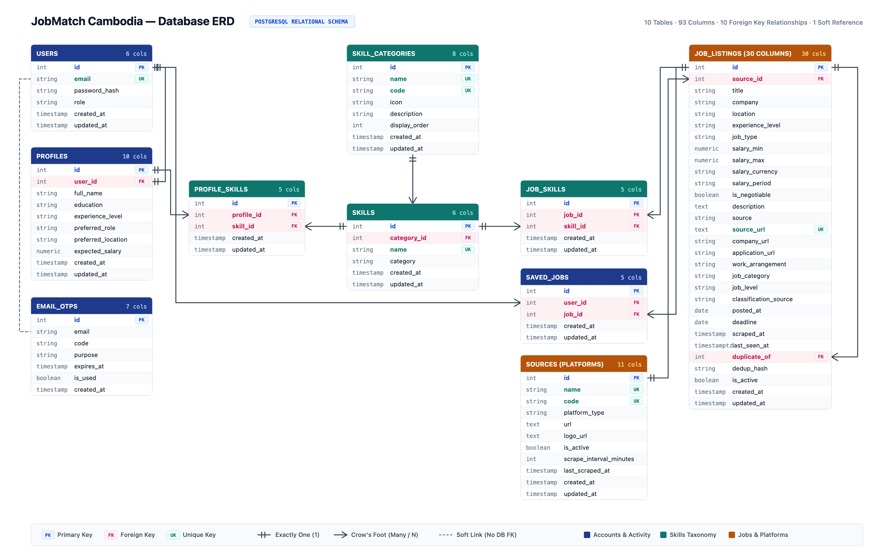

# JobMatch Cambodia — Database ERD

**Production PostgreSQL Relational Schema & Entity Relationship Model**  
*Summary: 10 Tables · 93 Columns · 10 Foreign Key Relationships · 1 Soft Reference*

---

## 1. Entity Relationship Diagram (Landscape Overview)

> **Diagram Guide:**
> - **Accounts & Activity (Navy Blue):** `users`, `profiles`, `email_otps`, `saved_jobs`
> - **Skills Taxonomy (Teal):** `skill_categories`, `skills`, `profile_skills`, `job_skills`
> - **Jobs & Platforms (Warm Amber):** `sources (platforms)`, `job_listings`
> - **Connectors:** Double bars `||` indicate *Exactly One (1)*; Crow's Foot indicates *Many (N)*; Dashed line represents *Soft Reference (No DB FK)*; Right Loop represents *Self-Referential Duplication Hierarchy*.

---

## 2. Foreign Key & Entity Relationships

| From Table | To Table | Relationship Type | Foreign Key Column | Referential Action |
|---|---|---|---|---|
| `users` | `profiles` | 1 : 1 (One-to-One) | `profiles.user_id → users.id` | ON DELETE CASCADE |
| `users` | `saved_jobs` | 1 : N (One-to-Many) | `saved_jobs.user_id → users.id` | ON DELETE CASCADE |
| `profiles` | `profile_skills` | 1 : N (One-to-Many) | `profile_skills.profile_id → profiles.id` | ON DELETE CASCADE |
| `skill_categories` | `skills` | 1 : N (One-to-Many) | `skills.category_id → skill_categories.id` | ON DELETE SET NULL |
| `skills` | `profile_skills` | 1 : N (One-to-Many) | `profile_skills.skill_id → skills.id` | ON DELETE CASCADE |
| `skills` | `job_skills` | 1 : N (One-to-Many) | `job_skills.skill_id → skills.id` | ON DELETE CASCADE |
| `job_listings` | `job_skills` | 1 : N (One-to-Many) | `job_skills.job_id → job_listings.id` | ON DELETE CASCADE |
| `job_listings` | `saved_jobs` | 1 : N (One-to-Many) | `saved_jobs.job_id → job_listings.id` | ON DELETE CASCADE |
| `sources` | `job_listings` | 1 : N (One-to-Many) | `job_listings.source_id → sources.id` | ON DELETE SET NULL |
| `job_listings` | `job_listings` | 1 : N (Self Reference) | `job_listings.duplicate_of → job_listings.id` | ON DELETE SET NULL |
| `users` | `email_otps` | Soft Link (1 : N) | `users.email ⤏ email_otps.email` | Application logic verification |

---

## 3. Data Dictionary & Table Specifications

### 1. `users` Table (Accounts & Authentication)
Stores candidate and administrator account identities, authentication credentials, and system roles.

| Column | Type | Key | Notes |
|---|---|---|---|
| `id` | integer | PK | Auto-incrementing primary key |
| `email` | varchar(255) | UK | Unique candidate login email address, indexed |
| `password_hash` | varchar(255) | - | Salted Bcrypt / Argon2 hashed password |
| `role` | varchar(20) | - | Role authorization string ('user', 'admin') |
| `created_at` | timestamp | - | Account creation timestamp (UTC) |
| `updated_at` | timestamp | - | Timestamp of last credential or role modification |

---

### 2. `profiles` Table (Candidate Profiles)
Stores candidate professional details, preferences, and matching profile data. Connected 1:1 with `users`.

| Column | Type | Key | Notes |
|---|---|---|---|
| `id` | integer | PK | Auto-incrementing primary key |
| `user_id` | integer | FK | FK → `users.id`, UNIQUE constraint enforcing 1:1, CASCADE on delete |
| `full_name` | varchar(150) | - | Candidate display name |
| `education` | varchar(150) | - | University degree, major, or institution |
| `experience_level` | varchar(50) | - | Seniority level ('entry', 'junior', 'mid', 'senior') |
| `preferred_role` | varchar(100) | - | Target job title (e.g., 'Flutter Developer') |
| `preferred_location` | varchar(100) | - | Desired work location ('Phnom Penh', 'Remote') |
| `expected_salary` | numeric(10,2) | - | Expected monthly compensation in USD (no float) |
| `created_at` | timestamp | - | Profile creation timestamp |
| `updated_at` | timestamp | - | Profile last update timestamp |

---

### 3. `email_otps` Table (Verification & Passwordless Auth)
Stores temporary cryptographic one-time passwords for email verification and secure passwordless login.

| Column | Type | Key | Notes |
|---|---|---|---|
| `id` | integer | PK | Auto-incrementing primary key |
| `email` | varchar(255) | - | Target recipient email address, indexed (soft link to `users.email`) |
| `code` | varchar(6) | - | 6-digit cryptographic verification code |
| `purpose` | varchar(50) | - | Purpose token ('register', 'login', 'reset') |
| `expires_at` | timestamp | - | Expiration timestamp (standard 10-minute window) |
| `is_used` | boolean | - | Status flag indicating whether the OTP code was redeemed |
| `created_at` | timestamp | - | Code generation timestamp |

---

### 4. `skill_categories` Table (Taxonomy Clusters)
Master taxonomy grouping technical tools and soft competencies into domain clusters (3NF Normalization).

| Column | Type | Key | Notes |
|---|---|---|---|
| `id` | integer | PK | Auto-incrementing primary key |
| `name` | varchar(100) | UK | Category title ('Mobile Development', 'Backend Development') |
| `code` | varchar(50) | UK | Machine-readable slug ('mobile', 'backend', 'database') |
| `icon` | varchar(50) | - | Material/Cupertino icon identifier for Flutter UI chips |
| `description` | text | - | Functional scope of tools included in this domain |
| `display_order` | integer | - | Visual sorting order on mobile candidate onboarding screen |
| `created_at` | timestamp | - | Category creation timestamp |
| `updated_at` | timestamp | - | Category last update timestamp |

---

### 5. `skills` Table (Normalized Skill Tokens)
Master catalog of standardized technical skills and competencies used by candidate profiles and matching algorithms.

| Column | Type | Key | Notes |
|---|---|---|---|
| `id` | integer | PK | Auto-incrementing primary key |
| `category_id` | integer | FK | FK → `skill_categories.id`, SET NULL on delete |
| `name` | varchar(50) | UK | Unique normalized skill name (e.g., 'Flutter', 'FastAPI', 'PostgreSQL') |
| `category` | varchar(50) | - | Denormalized category string for backward compatibility |
| `created_at` | timestamp | - | Skill creation timestamp |
| `updated_at` | timestamp | - | Skill last update timestamp |

---

### 6. `profile_skills` Table (Profile Skills Junction)
Many-to-many junction table associating candidate profiles with acquired skills.

| Column | Type | Key | Notes |
|---|---|---|---|
| `id` | integer | PK | Auto-incrementing primary key |
| `profile_id` | integer | FK | FK → `profiles.id`, CASCADE on delete |
| `skill_id` | integer | FK | FK → `skills.id`, CASCADE on delete |
| `created_at` | timestamp | - | Association timestamp |
| `updated_at` | timestamp | - | Record last update timestamp |

---

### 7. `job_skills` Table (Job Skills Junction)
Many-to-many junction table associating aggregated job listings with required technical skills extracted via NLP.

| Column | Type | Key | Notes |
|---|---|---|---|
| `id` | integer | PK | Auto-incrementing primary key |
| `job_id` | integer | FK | FK → `job_listings.id`, CASCADE on delete |
| `skill_id` | integer | FK | FK → `skills.id`, CASCADE on delete |
| `created_at` | timestamp | - | Association timestamp |
| `updated_at` | timestamp | - | Record last update timestamp |

---

### 8. `saved_jobs` Table (Candidate Bookmarks)
Stores bookmarks for jobs saved by candidates to review or apply to later.

| Column | Type | Key | Notes |
|---|---|---|---|
| `id` | integer | PK | Auto-incrementing primary key |
| `user_id` | integer | FK | FK → `users.id`, CASCADE on delete |
| `job_id` | integer | FK | FK → `job_listings.id`, CASCADE on delete |
| `created_at` | timestamp | - | Bookmark creation timestamp |
| `updated_at` | timestamp | - | Bookmark last update timestamp |

---

### 9. `sources` Table (Platform Registry)
Master registry of external recruitment websites and Telegram aggregation channels.

| Column | Type | Key | Notes |
|---|---|---|---|
| `id` | integer | PK | Auto-incrementing primary key |
| `name` | varchar(100) | UK | Human-readable platform name (e.g., 'CamHR', 'BongThom', 'Telegram Jobs') |
| `code` | varchar(50) | UK | Machine-readable slug ('camhr', 'bongthom', 'telegram_cambodia') |
| `platform_type` | varchar(50) | - | Type of platform ('telegram', 'web_portal', 'api') |
| `url` | text | - | Root platform or public channel URL |
| `logo_url` | text | - | Static CDN logo image URL for Flutter card badges |
| `is_active` | boolean | - | Scraping enabled flag (default true) |
| `scrape_interval_minutes` | integer | - | Scheduled ingestion frequency (default 60 minutes) |
| `last_scraped_at` | timestamp | - | Timestamp of most recent scraper execution |
| `created_at` | timestamp | - | Source record creation timestamp |
| `updated_at` | timestamp | - | Source record last update timestamp |

---

### 10. `job_listings` Table (Core Job Postings)
Primary storage table containing 30 normalized job vacancy columns scraped from external sources.

| Column | Type | Key | Notes |
|---|---|---|---|
| `id` | integer | PK | Auto-incrementing primary key |
| `source_id` | integer | FK | FK → `sources.id`, SET NULL on delete |
| `title` | varchar(200) | - | Cleaned job title |
| `company` | varchar(150) | - | Verified hiring organization name |
| `location` | varchar(100) | - | Job location (e.g., 'Phnom Penh', 'Siem Reap', 'Remote') |
| `experience_level` | varchar(50) | - | Seniority requirement ('entry', 'junior', 'mid', 'senior') |
| `job_type` | varchar(50) | - | Employment arrangement ('full-time', 'part-time', 'internship') |
| `salary_min` | numeric(10,2) | - | Minimum salary in USD (no float) |
| `salary_max` | numeric(10,2) | - | Maximum salary in USD (no float) |
| `salary_currency` | varchar(10) | - | Currency denomination ('USD', 'KHR') |
| `salary_period` | varchar(20) | - | Pay frequency ('monthly', 'yearly', 'hourly') |
| `is_negotiable` | boolean | - | Flag indicating negotiable compensation |
| `description` | text | - | Full cleaned job description and requirements text |
| `source` | varchar(50) | - | Origin source identifier string |
| `source_url` | text | UK | Direct URL to original posting, enforced unique |
| `company_url` | string | - | Official hiring company website |
| `application_url` | string | - | External application URL or portal link |
| `work_arrangement` | string | - | Workplace setting ('on-site', 'hybrid', 'remote') |
| `job_category` | string | - | Primary technical industry domain |
| `job_level` | string | - | Standardized seniority classification |
| `classification_source` | string | - | Classifier model flag ('jev' or 'rule') |
| `posted_at` | date | - | Original publication date on source platform |
| `deadline` | date | - | Application deadline date |
| `scraped_at` | timestamp | - | Initial scraping ingestion timestamp |
| `last_seen_at` | timestamptz | - | Timestamp of most recent scraping confirmation |
| `duplicate_of` | integer | FK | Self-reference FK → `job_listings.id` for cross-source duplicates |
| `dedup_hash` | varchar(64) | - | MD5 fingerprint hash for deduplication |
| `is_active` | boolean | - | Active vacancy visibility flag |
| `created_at` | timestamp | - | Record insertion timestamp |
| `updated_at` | timestamp | - | Record last update timestamp |

---

## 4. Suggested Schema Improvements (Architectural Recommendations)

> [!NOTE]
> The following items represent industry best-practice architectural recommendations for production readiness. These suggestions are documented for review and do not alter the current base diagram.

1. **Composite Unique Constraints on Junction Tables:**
   - Add `UNIQUE(profile_id, skill_id)` on `profile_skills` and `UNIQUE(job_id, skill_id)` on `job_skills` to prevent duplicate skill associations at the database constraint layer.
2. **Explicit 1:1 Unique Constraint on Candidate Profiles:**
   - Add `UNIQUE(user_id)` on `profiles` to strictly enforce that one user account can never instantiate more than one candidate profile.
3. **Formal Referential Action Rules (ON DELETE):**
   - Apply `ON DELETE CASCADE` on candidate-owned records (`profiles`, `profile_skills`, `saved_jobs`) to ensure clean GDPR/data deletion compliance when an account is deleted.
   - Apply `ON DELETE SET NULL` on `job_listings.source_id`, `job_listings.duplicate_of`, and `skills.category_id` to preserve historical job postings even if an external scraping source or taxonomy node is removed.
4. **Retire Denormalized Columns in Favor of Normalized Foreign Keys:**
   - Migrate away from `skills.category` (string) in favor of `skills.category_id → skill_categories.id`.
   - Migrate away from `job_listings.source` (string) in favor of `job_listings.source_id → sources.id`.
5. **Timezone-Aware Timestamps (`timestamptz` Consistency):**
   - Standardize all `created_at`, `updated_at`, `scraped_at`, and `expires_at` columns across all tables to `timestamptz` (UTC) to eliminate offset discrepancies between Cambodia local time (UTC+7) and cloud backend hosts.
6. **Mobile Feed B-Tree Composite Indexes:**
   - Create composite B-Tree indexes on `job_listings(is_active, posted_at DESC)` and `job_listings(job_category, posted_at DESC)` to enable sub-50ms mobile feed pagination and category filtering.
7. **Transient OTP Cleanup Strategy:**
   - Implement an automated cron or PostgreSQL partition retention policy to prune consumed (`is_used = true`) or expired (`expires_at < now()`) OTP records older than 24 hours.
