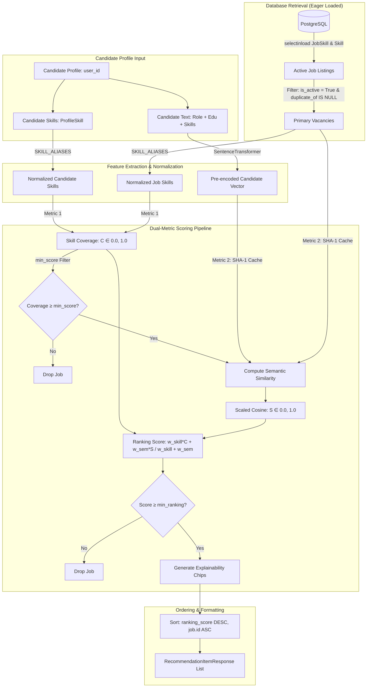

# JobMatch Recommendation Engine — Technical Documentation

## 1. Overview
The JobMatch recommendation engine matches registered candidates to active Cambodian job vacancies using two scoring components: verified skill overlap and multilingual text similarity. Technical skill requirements are calculated through alias normalization, while job descriptions and candidate profiles are compared using dense sentence embeddings. The combined ranking balances technical capabilities with semantic discovery across vacancy postings.

---

## 2. Architecture



---

## 3. Pipeline in Code Order

The execution sequence inside `compute_ai_recommendations` (`backend/app/services/matching_engine.py`) follows this order:

1. **Candidate Skills & Profile Retrieval**: Queries `Skill` entities via `ProfileSkill` for the candidate. Lowers and trims names to produce `candidate_skills_lower` and builds a plain-text candidate summary (`_build_candidate_text`).
2. **Candidate Pre-Encoding**: Encodes the candidate text once using `_get_embedding_model()`. The resulting 384-dimensional unit-norm vector is stored in memory as `candidate_emb`.
3. **Candidate Skill Normalization**: Canonicalizes candidate skills via `SKILL_ALIASES` into `candidate_skills_normalized`.
4. **Database Query (Eager Loaded)**: Queries active job listings (`JobListing.is_active == True`, `JobListing.duplicate_of.is_(None)`) using `selectinload(JobListing.skills).selectinload(JobSkill.skill)` to prevent N+1 database queries. If no active jobs exist, returns `[]`.
5. **Per-Job Scoring Loop**:
   - Extracts raw job skills and lowercases them.
   - **Zero-skill job check**: If the job has no listed skills:
     - If `min_score > 0`, drops the job.
     - Calculates semantic similarity.
     - Sets `ranking = semantic if w_semantic > 0.0 else 0.0`.
     - Appends item with `required_skill_coverage = 0.0`, `matched_skills = []`, `missing_skills = []`.
   - **Regular job with skills**:
     - Computes `coverage = _compute_skill_coverage(candidate_skills, job_skills)`.
     - **`min_score` filter**: If `min_score > 0` and `round(coverage * 100) < min_score`, drops the job.
     - Retrieves or calculates semantic similarity `semantic` using cached job embeddings.
     - **Ranking Score**: If the candidate has no skills, `ranking = semantic if w_semantic > 0.0 else 0.0`; otherwise, `ranking = (w_skill * coverage + w_semantic * semantic) / (w_skill + w_semantic)`.
     - **`min_ranking` filter**: If `min_ranking > 0.0` and `ranking < min_ranking`, drops the job.
     - Deduplicates `matched_skills` and `missing_skills` while preserving original listing order.
6. **Deterministic Sort & Tie-Break**: Sorts the collected list with `results.sort(key=lambda x: (-x["ranking_score"], x["job"].id))`.

---

## 4. API Reference: `GET /api/v1/recommendations`

### Query Parameters
| Parameter | Type | Range | Default | Description |
|---|---|:---:|:---:|---|
| `min_score` | `integer` | `0` to `100` | `0` | Minimum `required_skill_coverage * 100` required to include a job. Zero-skill jobs have coverage 0.0 and are excluded when `min_score > 0`. |
| `min_ranking` | `float` | `0.0` to `1.0` | `0.0` | Minimum `ranking_score` required to include a job. Filters out low overall ranking scores. |
| `w_skill` | `float` | `0.0` to `1.0` | `0.70` | Weight assigned to `required_skill_coverage` in `ranking_score`. |
| `w_semantic` | `float` | `0.0` to `1.0` | `0.30` | Weight assigned to `semantic_similarity` in `ranking_score`. |

### Error Responses
1. **Unauthenticated Request (401 Unauthorized)**:
   ```json
   {
     "detail": "Not authenticated"
   }
   ```
2. **Degenerate Weight Parameters (422 Unprocessable Entity)**:
   Raised when `w_skill + w_semantic < 1e-6`:
   ```json
   {
     "detail": {
       "error": {
         "code": "INVALID_WEIGHTS",
         "message": "w_skill and w_semantic cannot both be zero. At least one weight must be greater than 0 so that ranking_score produces a meaningful ordering. Example: w_skill=0.7, w_semantic=0.3 (default).",
         "details": {
           "w_skill": 0.0,
           "w_semantic": 0.0,
           "combined": 0.0,
           "minimum_combined": 1e-06
         }
       }
     }
   }
   ```
3. **Range Validation Error (422 Unprocessable Entity)** (e.g. `min_score=-1` or `w_skill=2.0`):
   FastAPI validation envelope detailing parameter bounds violation.

### Example Request and Response (illustrative, values invented)
**Request**:
```http
GET /api/v1/recommendations?min_score=0&min_ranking=0.50&w_skill=0.70&w_semantic=0.30 HTTP/1.1
Host: localhost:8000
Authorization: Bearer <access_token>
```

**Response (200 OK)**:
```json
[
  {
    "job": {
      "id": 101,
      "title": "Junior Flutter Developer",
      "company": "Smart Axiata",
      "location": "Phnom Penh",
      "experience_level": "entry",
      "job_type": "full-time",
      "salary_min": 400.0,
      "salary_max": 700.0,
      "salary_currency": "USD",
      "salary_period": "monthly",
      "is_negotiable": false,
      "work_arrangement": "on-site",
      "status": "active",
      "application_url": null,
      "company_url": null,
      "company_logo_url": null,
      "raw_title": "Junior Flutter Developer",
      "normalized_location": "Phnom Penh",
      "openings": 1,
      "source_post_id": "smart_101",
      "scraped_at": "2026-10-24T12:00:00",
      "dedup_hash": "a1b2c3d4e5f6",
      "source": "Web",
      "source_url": "https://example.com/job/101",
      "posted_at": "2026-10-20",
      "deadline": "2026-11-20",
      "skills": ["Flutter", "Dart", "REST API", "Git"]
    },
    "required_skill_coverage": 1.0,
    "semantic_similarity": 0.8124,
    "ranking_score": 0.9437,
    "matched_skills": ["Flutter", "Dart", "REST API", "Git"],
    "missing_skills": [],
    "match_score": 100
  }
]
```

---

## 5. Components & Logic

### Skill Normalization (`SKILL_ALIASES`)
Normalizes strings by lowercasing, collapsing internal whitespace, and mapping against `SKILL_ALIASES`. Examples:
- `"ReactJS"`, `"React.js"`, `"react js"` $\rightarrow$ `"react"`
- `"Node.js"`, `"node"` $\rightarrow$ `"nodejs"`
- `"PostgreSQL"`, `"postgres"`, `"postgre"` $\rightarrow$ `"postgresql"`
- `"Flutter Framework"` $\rightarrow$ `"flutter"`
- `"Python3"`, `"py"` $\rightarrow$ `"python"`

### Skill Coverage Formula
$$\text{Coverage} = \frac{|\text{Candidate Skills Normalized} \cap \text{Job Skills Normalized}|}{|\text{Job Skills Normalized}|}$$
- Returns `0.0` if `job_skills` is empty.
- Returns `0.0` if `candidate_skills` is empty.

### Semantic Similarity
- **Model**: `paraphrase-multilingual-MiniLM-L12-v2` (`sentence-transformers`).
- **Embedding Dimensions**: 384 dimensions (normalized unit vectors).
- **Verified Parameters**: 117,653,760 (~118 M parameters).
- **Score Normalization**: Maps raw cosine similarity $[-1.0, 1.0]$ to $[0.0, 1.0]$:
  $$\text{Semantic} = \frac{\cos(\theta) + 1.0}{2.0}$$
  *Compression note*: Unrelated texts typically yield raw cosine near $0.0$, which compresses into normalized semantic scores near $0.50$. It serves as a relative ranking floor rather than an absolute percentage.

### Embedding Cache Architecture
- **In-Memory Cache**: `OrderedDict[int, Tuple[str, np.ndarray]]` keyed by `job_id`.
- **Cache Invalidation & Updates**: Stores `(sha1_hash, vector)`. If a job description changes, its SHA-1 hash changes; the engine recomputes the embedding and overwrites the entry in-place without key accumulation.
- **LRU Size Cap**: Capped at `5,000` entries via `MAX_CACHE_SIZE`. When the limit is exceeded, `popitem(last=False)` discards the oldest entry.
- **Batch Warming**: `warm_job_embeddings(db, batch_size=32)` batch-encodes active primary jobs on startup when enabled. Note: calling `warm_job_embeddings` also loads the embedding model into memory.

---

## 6. Configuration Settings

| Setting | Location | Default | Description |
|---|---|:---:|---|
| `WARM_EMBEDDINGS_ON_STARTUP` | `app/core/config.py` | `False` | When `True`, pre-encodes active jobs in batches during app lifespan boot and loads the model into RAM. |
| `_EMBEDDING_MODEL_NAME` | `app/services/matching_engine.py` | `"paraphrase-multilingual-MiniLM-L12-v2"` | Hugging Face model repository identifier. |
| `MAX_CACHE_SIZE` | `app/services/matching_engine.py` | `5000` | Maximum job vectors maintained in RAM before LRU eviction. |
| `_MIN_COMBINED_WEIGHT` | `app/api/recommendations.py` | `1e-6` | Minimum sum of `w_skill + w_semantic` to avoid degenerate scoring. |

---

## 7. Performance Benchmarks

### In-Memory Benchmark (30 Representative Postings, 5 Runs)
*Source: `backend/scripts/latency_5runs.txt` (5-run benchmark):*
- **Cold Encoding (all 30 jobs once):** median = **525.5 ms** (min = 504.3 ms, max = 906.2 ms)
- **Warm Ranking Only (candidate pre-encoded):** median = **0.49 ms** (min = 0.49 ms, max = 1.02 ms; about 0.5 to 1 ms)
- **Warm End-to-End (includes candidate encoding):** median = **18.24 ms** (min = 17.66 ms, max = 29.01 ms)
- **Candidate text encoding duration:** approximately 18 ms (derived: end-to-end minus ranking-only, median 17.75 ms)
- Excludes database queries and network transport. Single-run sample captured in `backend/scripts/evaluation_results.txt` (cold 580.5 ms, warm rank 0.59 ms, warm e2e 19.75 ms).

### Endpoint Benchmark (18 Active Jobs, PostgreSQL `jobmatch_db`)
*Source: `backend/scripts/benchmark_endpoint_results.txt`:*
- **Cold HTTP Request (all 18 active jobs, empty RAM cache):** 11,371.58 ms
- **Warm HTTP Request:** mean 39.99 ms (range 36.00-48.08 ms, 20 calls, 18 jobs)
- Includes: PostgreSQL eager queries (5 statements), candidate text encoding, cached job lookups, and JSON serialization. Scaling beyond the measured 18 jobs has not been benchmarked.

---

## 8. Empirical Evaluation (Benchmark Set)

- **Dataset**: 30 representative postings written by the author (15 English listings + 15 Khmer/English bilingual listings) evaluated across 5 candidate profiles.
- **Ground Truth Labels**: Binary relevance judgments (30 x 5 matrix) defined by the author.
- **Metrics**: Precision@5 ($P@5$) and Recall@5 ($R@5$).

### Random-Ranking Baseline Calculation
The theoretical random-ranking expectation is determined directly from `LABELS`:
$$\text{Expected } P@5 = \frac{\text{mean}(|\text{relevant}|)}{\text{pool size}}, \quad \text{Expected } R@5 = \frac{5}{\text{pool size}}$$
- **Full 30-Job Set**: Profiles have 6, 5, 5, 6, and 4 relevant jobs (total 26, mean 5.2). Pool size = 30.
  $$\text{Expected } P@5 = \frac{5.2}{30} = 0.17, \quad \text{Expected } R@5 = \frac{5}{30} = 0.17$$
- **15-Job Khmer Subset**: Profiles have 2, 2, 2, 3, and 2 relevant jobs (total 11, mean 2.2). Pool size = 15.
  $$\text{Expected } P@5 = \frac{2.2}{15} = 0.15, \quad \text{Expected } R@5 = \frac{5}{15} = 0.33$$

The benchmark is easy because profile role text shares words with relevant job titles, so the three hybrid weightings tie at the ceiling.

### System Comparison (All 30 Representative Jobs)
*Source: `backend/scripts/evaluation_results.txt`:*

| System Configuration | Weights ($w_{\text{skill}} / w_{\text{sem}}$) | P@5 | R@5 | Profiles |
|---|:---:|:---:|:---:|:---:|
| Random ranking (baseline) | N/A | 0.17 | 0.17 | 5 |
| Skills only | 1.0 / 0.0 | 0.72 | 0.72 | 5 |
| Semantic only | 0.0 / 1.0 | 0.72 | 0.72 | 5 |
| Hybrid 0.5/0.5 | 0.5 / 0.5 | 0.76 | 0.75 | 5 |
| **JobMatch 0.7/0.3** | **0.7 / 0.3** | **0.76** | **0.75** | **5** |
| Hybrid 0.9/0.1 | 0.9 / 0.1 | 0.76 | 0.75 | 5 |

*Evaluation finding:* Any hybrid weighting from 0.2/0.8 to 0.9/0.1 gave the same P@5 and R@5, so this set cannot distinguish between them, and the single-signal baselines scored 0.04 lower (one relevant job for one profile on this small set).

### Khmer / Bilingual Subset Only (15 Jobs)
*Source: `backend/scripts/evaluation_results.txt`:*

| System Configuration | Weights ($w_{\text{skill}} / w_{\text{sem}}$) | P@5 | R@5 | Profiles |
|---|:---:|:---:|:---:|:---:|
| Random ranking (baseline) | N/A | 0.15 | 0.33 | 5 |
| Skills only | 1.0 / 0.0 | 0.36 | 0.87 | 5 |
| Semantic only | 0.0 / 1.0 | 0.32 | 0.77 | 5 |
| Hybrid 0.5/0.5 | 0.5 / 0.5 | 0.36 | 0.87 | 5 |
| **JobMatch 0.7/0.3** | **0.7 / 0.3** | **0.36** | **0.87** | **5** |
| Hybrid 0.9/0.1 | 0.9 / 0.1 | 0.36 | 0.87 | 5 |

*Khmer evaluation analysis:*
On the 15-job Khmer subset, skills-only and hybrid reached Recall@5 0.87 and semantic-only 0.77. The Khmer postings contain English skill words, so this does not show the model understands Khmer.
Precision@5 on this subset is capped by the number of relevant Khmer jobs per profile:
- Profiles 1, 2, 3, and 5 each have 2 relevant jobs in the Khmer pool (max P@5 = 2/5 = 0.40).
- Profile 4 has 3 relevant jobs in the Khmer pool (max P@5 = 3/5 = 0.60).
- Exact mean cap across 5 profiles: $(2 + 2 + 2 + 3 + 2) / 25 = 11 / 25 = 0.44$.
The achieved score of 0.36 represents 81.8% of this theoretical 0.44 cap.

### Real Error Cases From Output
*Source: `backend/scripts/evaluation_results.txt`:*
1. **Profile 2 (Backend Python Developer)**:
   - Job `123` (*Junior Python / AI Intern*): Engine scored cov=0.50, sem=0.75. Ground truth rule marked non-relevant (`✗`).
   - Job `106` (*Machine Learning Engineer*): Engine scored cov=0.50, sem=0.67. Ground truth rule marked non-relevant (`✗`).
2. **Profile 4 (Fresh IT Graduate, No Skills Tagged)**:
   - Job `117` (*Python Backend Developer (បន្ទាន់)*): Engine scored cov=0.00, sem=0.73. Ground truth rule marked non-relevant (`✗`).
   - Job `116` (*Mobile App Dev (Flutter)*): Engine scored cov=0.00, sem=0.73. Ground truth rule marked non-relevant (`✗`).
   - Job `129` (*General Admin Clerk*): Engine scored cov=0.00, sem=0.72. Ground truth rule marked non-relevant (`✗`).
   - *Note on Profile 4:* Because Profile 4 has no tagged skills, its recommendations were driven entirely by semantic similarity from the candidate's target role and education text, demonstrating the engine's graceful semantic fallback on un-tagged profiles.

---

## 9. Known Limitations

1. **Zero-Skill Jobs Scoring Behavior**: When a job lists no skills, coverage is unknown and the engine ranks it by semantic similarity alone (`ranking = semantic`). In testing, a zero-skill job with semantic score 0.70 ranks higher (0.70) than a job with 50% skill coverage and the same 0.70 semantic score (which scores $(0.70 \times 0.50 + 0.30 \times 0.70) = 0.56$), because the zero-skill job is not penalized for missing skills. Jobs with no listed skills are ranked by semantic similarity alone and can rank above jobs where the candidate matches only some skills; all 30 benchmark jobs have skills, so this case is not covered by the benchmark.
2. **Khmer Language Pre-Training**: Khmer is not listed in the training languages on the `paraphrase-multilingual-MiniLM-L12-v2` model card; performance on Khmer text was measured empirically on 15 jobs only.
3. **Small Benchmark Set**: The evaluation set contains 30 representative postings written by the author and 5 candidate profiles. Statistical variance is high (a 0.04 P@5 shift represents one vacancy).
4. **Static Taxonomy**: Skill normalization depends on static dictionaries (`SKILL_ALIASES`); unmapped novel libraries will not match unless manually registered.

---

## 10. Troubleshooting

- **Model fails to load**: The engine logs a single clear `ERROR` stating: `Embedding model (...) failed to load. Semantic similarity is disabled and ranking is skills-only.` Semantic scores fall back to `0.0`, and ranking operates on skill coverage alone.
- **Candidate has no skills**: Ranked by semantic similarity only (`ranking = semantic`) to prevent all scores collapsing to zero.
- **Job has no skills**: Coverage defaults to `0.0`, explainability chips are empty lists `[]`, and ranking uses semantic similarity only. Such jobs are excluded if `min_score > 0`.
- **Slow first request**: Caused by cold model initialization and populating `_job_embedding_cache`. Set `WARM_EMBEDDINGS_ON_STARTUP=True` in `.env` to pre-warm cache during startup. Note: this will also load the embedding model into memory on startup.

---

## 11. How to Extend

- **Add Skill Aliases**: Append entries in `SKILL_ALIASES` inside `backend/app/services/matching_engine.py` (e.g. `"vue3": "vue"`).
- **Change Embedding Model**: Modify `_EMBEDDING_MODEL_NAME` in `matching_engine.py`. Ensure the replacement model produces unit-norm embeddings or normalize with `normalize_embeddings=True`.
- **Tune Default Weights**: Adjust `w_skill` and `w_semantic` default values in `get_recommendations` (`app/api/recommendations.py`) and `compute_ai_recommendations`.
- **Rerun Evaluation**: Run `python scripts/evaluate_real_engine.py` from `backend/` to generate updated benchmark tables.

---

## 12. Testing Coverage

The recommendation engine is covered by automated tests in `backend/tests/test_recommendations.py`:
- **What is covered**:
  - Response schema, field names, and nested job attributes.
  - Value ranges ($[0.0, 1.0]$) and independence of coverage vs semantic metrics.
  - Descending ranking score order and deterministic `job.id` ascending tie-breaking.
  - Weight configuration parameters and degenerate weight handling (`422 INVALID_WEIGHTS`).
  - Zero-skill job handling, zero-skill candidate semantic fallback, and zero-skill comparison with 50% coverage.
  - Alias matching in explainability chips.
  - `min_ranking` and `min_score` filtering.
  - Embedding model load failure fallback via monkeypatching.
  - In-memory cache reuse and SHA-1 replacement upon text mutation.
  - N+1 query prevention asserting that the database query executes exactly 5 SQL statements.
- **What is not covered**:
  - GPU tensor allocation (tests run on CPU).
  - Network disconnection during Hugging Face initial download.
  - Concurrency locks under multi-threaded cache writes.
